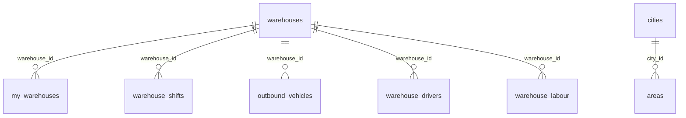
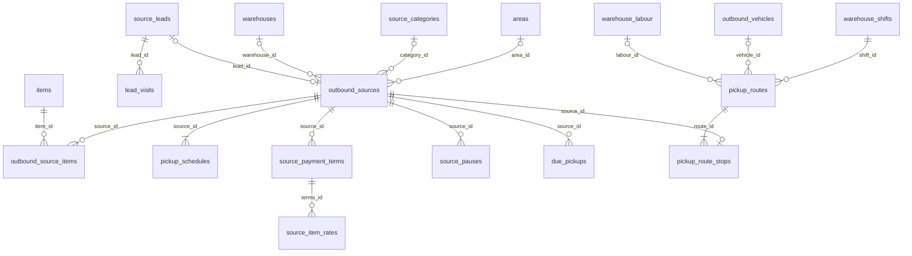
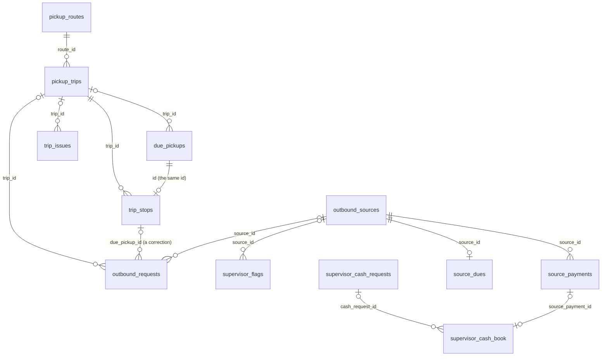

# EERL Outbound — SQLite Schema & Queries

> Local context snapshot from [the Outbound schema and query artifact](https://claude.ai/artifact/SgG4rrHB8JVR2nbLL3Cfyz#024ceeac-c7d4), captured on 27 Nov 2026. Covers the Driver and Pickup Supervisor (outbound) module. Update only when the user explicitly requests it.

Oct 14, 2026 · @Chintan Adhvaryu

Every table the app keeps for outbound collection, and every statement and query it runs: the schema, how `/bootstrap` fills it, the outbox writes, and each screen's queries, role by role. **EERL Outbound — Offline Data Guide** explains the flows and the reasons; this doc is what to type. Fixed-point tables and queries stay in the fixed-point SQLite doc.

## Conventions

Outbound uses the fixed-point doc's conventions and its shared tables, so one sync loop and one outbox serve both.

| Thing | Rule |
| --- | --- |
| Ids | `TEXT` uuids. The app makes the id of everything it creates (leads, visits, pickup points, schedules, payment terms, pauses, extra pickups, routes, entries, issues, requests, cash requests, payments, agreements) and sends it in the URL, so a retry never makes a second record. The server makes scheduled pickups, trips, flags and cash book lines. |
| Column names | The same as the `/bootstrap` row keys, so a row is inserted as it arrives. |
| Booleans | `INTEGER` 1 / 0, as `/bootstrap` sends them. |
| Money and weights | `REAL` rupees and KG; quantities are in the item's unit (KG or pieces). Round only when showing them. |
| Times | `TEXT` ISO-8601 UTC (`2026-11-26T08:35:00.000Z`). Show them in IST. |
| Days and clock times | IST days are `TEXT` `YYYY-MM-DD`. Shift and pickup-window times are `TEXT` `HH:MM`, IST. |
| JSON columns | `TEXT` holding JSON: photo lists (`photo_urls`, `slip_photo_urls`), `item_ids`, `entry_lines`, `skip_reasons`, `types`, `pin_codes`, the schedule arrays, `proposed`, `previous`. Read them with `json_each()` and `json_extract()`. |
| `sync_state` | `'synced'` = matches the server. `'pending'` = changed on the phone, waiting in the outbox. `'failed'` = the server refused it; shown in Sync Status. Only on tables the phone writes to. |
| Parameters | `:me` = `me.user.id`; `:my_name`, `:my_phone` = `me.user.name`, `.phone`; `:today`, `:tomorrow`, `:yesterday` = IST days; `:now` = the current UTC time. |
| Transactions | A write and its outbox item run in one transaction; so does one `/bootstrap` page. |
| Shared tables | `sync_meta`, `my_roles`, `outbox`, `outbox_photos`, `photos`, `notifications` and `items` are the fixed-point doc's. Outbound only adds tables, and adds lines to the shared sync steps. `my_roles.role_key` may also hold `PICKUP_SUPERVISOR`, `DRIVER`, `IEC` or `WAREHOUSE`. |
| Reference and records | Reference tables come whole, as `replace`. Record tables come as `upserts` and `deletes`. |

## The schema

Run this once on first launch, after the fixed-point schema. A fresh install creates every table and index below; there is no `ALTER`. Links are written as `REFERENCES` clauses for reading and are never enforced (`PRAGMA foreign_keys` stays OFF, as in the fixed-point doc): a page can bring a row before its parent, and some ids name rows a phone never holds. Columns marked "server user id" name a person on the server; the phone has no users table, so the name travels beside the id.

### Reference tables

Sent whole as `replace`, only to someone holding an outbound role. None has a `sync_state` column: the phone never writes them. `my_warehouses` is filled from `me.warehouses` on every call.

```sql
CREATE TABLE my_warehouses (               -- from me.warehouses: where a Driver or Warehouse Incharge works
  warehouse_id TEXT PRIMARY KEY REFERENCES warehouses (id),
  is_primary   INTEGER NOT NULL DEFAULT 0  -- 1: the one to open on
);

CREATE TABLE warehouses (                  -- outbound roles only
  id              TEXT PRIMARY KEY,
  name            TEXT NOT NULL,
  code            TEXT NOT NULL,            -- e.g. SCH; starts trip and labour numbers
  address         TEXT,
  lat             REAL,
  lng             REAL,
  in_charge_name  TEXT,                     -- the warehouse's in-charge, for Call warehouse (26 Nov 2026)
  in_charge_phone TEXT                      -- NULL: no in-charge set; hide Call warehouse
);

CREATE TABLE warehouse_shifts (
  id           TEXT PRIMARY KEY,
  warehouse_id TEXT NOT NULL REFERENCES warehouses (id),
  name         TEXT NOT NULL,               -- Morning, Night …
  start_time   TEXT NOT NULL,               -- HH:MM, IST
  end_time     TEXT NOT NULL,               -- HH:MM, IST; earlier than start_time = ends the next day
  sort_order   INTEGER NOT NULL DEFAULT 0,
  is_active    INTEGER NOT NULL DEFAULT 1   -- 0: switched off; kept so old trips still name it
);

CREATE TABLE outbound_vehicles (           -- our pickup vans; never in the fixed-point vehicles table (D2D)
  id           TEXT PRIMARY KEY,
  number       TEXT,                        -- the server's reference number
  warehouse_id TEXT NOT NULL REFERENCES warehouses (id),
  plate_number TEXT NOT NULL,
  type_name    TEXT NOT NULL,               -- the vehicle type; '' when none
  capacity_kg  REAL,                        -- KG; NULL: not given
  is_active    INTEGER NOT NULL DEFAULT 1
);

CREATE TABLE warehouse_drivers (           -- people with the Driver role, per warehouse they work at (or left)
  user_id      TEXT NOT NULL,               -- server user id (pickup_routes.driver_id, pickup_trips.driver_id)
  warehouse_id TEXT NOT NULL REFERENCES warehouses (id),
  number       TEXT,                        -- the driver code, SUR-DRV-0001
  name         TEXT NOT NULL,
  phone        TEXT NOT NULL,               -- their login
  id_number    TEXT,                        -- Aadhaar or Voter ID, as typed
  photo_url    TEXT,                        -- profile photo
  id_proof_url TEXT,                        -- ID proof photo
  is_active    INTEGER NOT NULL DEFAULT 1,  -- 0: taken off this warehouse (Deactivate) and placed nowhere since;
                                            --   listed for the Deactivated list and Reactivate (26 Nov 2026)
  PRIMARY KEY (user_id, warehouse_id)
);

CREATE TABLE warehouse_labour (            -- loaders who ride on trips; not app users
  id           TEXT PRIMARY KEY,
  number       TEXT,                        -- SCH-LAB-0001
  warehouse_id TEXT NOT NULL REFERENCES warehouses (id),
  name         TEXT NOT NULL,
  phone        TEXT,
  id_number    TEXT,                        -- Aadhaar or Voter ID, as typed
  photo_url    TEXT,                        -- profile photo
  id_proof_url TEXT,                        -- ID proof photo
  is_active    INTEGER NOT NULL DEFAULT 1   -- 0: deactivated; still listed
);

CREATE TABLE cities (
  id   TEXT PRIMARY KEY,
  name TEXT NOT NULL
);

CREATE TABLE areas (
  id                     TEXT PRIMARY KEY,
  city_id                TEXT NOT NULL REFERENCES cities (id),
  name                   TEXT NOT NULL,
  pin_codes              TEXT NOT NULL,     -- JSON array of 6-digit PIN codes, e.g. ["395005","395009"]
  pickup_supervisor_id   TEXT,              -- server user id; NULL: nobody covers it yet
  pickup_supervisor_name TEXT
);

CREATE TABLE source_categories (           -- the pickup point type picker: Shop, Society… (IEC)
  id   TEXT PRIMARY KEY,
  name TEXT NOT NULL
);
```

Who gets which table. A role that does not get a table never sees its key; a key missing from a response means "no change".

| Table | Pickup Supervisor | IEC Executive | Driver, Warehouse Incharge |
| --- | --- | --- | --- |
| `my_warehouses` (from `me`) | — | — | the warehouses they are placed at |
| `warehouses` | every active warehouse with a code | the same | their own |
| `warehouse_shifts` | every warehouse's | — | their warehouses' |
| `outbound_vehicles`, `warehouse_drivers`, `warehouse_labour` | every warehouse's (vans and labour switched off too) | — | — |
| `cities` | active | active | — |
| `areas` | the ones they cover | every active one | — |
| `source_categories` | — | active types for pickup points | — |

### Pickup points and leads

A pickup point (a "source" on the server) arrives with all its children: its items, every schedule version, every payment terms version with its item rates, and its pauses. A lead arrives with its visits.

```sql
CREATE TABLE outbound_sources (            -- a pickup point
  id                      TEXT PRIMARY KEY,   -- made by the app when the IEC registers it
  number                  TEXT,               -- SUR-SRC-0001; NULL until the server has it
  status                  TEXT NOT NULL,      -- PENDING_APPROVAL | ACTIVE | PAUSED | REJECTED | ENDED
  name                    TEXT NOT NULL,
  category_id             TEXT REFERENCES source_categories (id),
  category_name           TEXT,
  material_mode           TEXT,               -- SORTED | MIXED
  is_event                INTEGER NOT NULL DEFAULT 0,  -- 1: a temporary event point (schedule ends within 60 days)
  pickup_category         TEXT,               -- DAILY | WEEKLY | BI_WEEKLY | MONTHLY | ON_CALL | ONE_TIME, from the
                                              --   schedule in force today; NULL: no schedule
  area_id                 TEXT REFERENCES areas (id),
  area_name               TEXT,
  city_name               TEXT,
  warehouse_id            TEXT REFERENCES warehouses (id),  -- where its pickups normally go
  pickup_supervisor_id    TEXT,               -- server user id; NULL until approved, or while nobody covers the area
  pickup_supervisor_name  TEXT,
  pickup_supervisor_phone TEXT,
  address                 TEXT,
  lat                     REAL,               -- the pin, at the pickup spot: the driver's GPS is matched to it
  lng                     REAL,
  contact_name            TEXT,               -- the person at the pickup point
  contact_phone           TEXT,
  contact_role            TEXT,               -- their role: Owner, Manager, Watchman…
  contact_email           TEXT,
  source_user_phone       TEXT,               -- who will use the Source role (not used by the app yet)
  notes                   TEXT,
  photo_urls              TEXT NOT NULL DEFAULT '[]',  -- JSON array
  registered_by_id        TEXT,               -- server user id of the IEC who registered it
  registered_by_name      TEXT,
  iec_owner_id            TEXT,               -- server user id of the IEC who looks after it (My pickup points);
                                              --   the registrant at first, the admin may change it; NULL: nobody
  iec_owner_name          TEXT,
  iec_owner_phone         TEXT,               -- Call the IEC Executive on Pickup point detail (26 Nov 2026)
  lead_id                 TEXT REFERENCES source_leads (id),  -- the lead it came from
  revision                INTEGER NOT NULL DEFAULT 1,  -- + 1 on each resubmit after a rejection
  submitted_at            TEXT,
  decided_at              TEXT,               -- approved or rejected
  rejection_reason        TEXT,
  agreement_status        TEXT,               -- its latest agreement not ended: DRAFT | PENDING_APPROVAL | SENT_BACK
                                              --   | ACTIVE | EXPIRED; NULL: none
  agreement_ends_on       TEXT,               -- YYYY-MM-DD
  updated_at              TEXT,
  sync_state              TEXT NOT NULL DEFAULT 'synced'  -- pending while the IEC's change is unsent
);

CREATE TABLE outbound_source_items (       -- a Sorted pickup point's items, in pickup-form order
  id         TEXT PRIMARY KEY,
  source_id  TEXT NOT NULL REFERENCES outbound_sources (id),
  item_id    TEXT NOT NULL REFERENCES items (id),  -- a KG item
  sort_order INTEGER NOT NULL
);

CREATE TABLE pickup_schedules (            -- every version; the one in force on a day is the latest effective_from
  id              TEXT PRIMARY KEY,         --   on or before it (none started yet: the first one)
  source_id       TEXT NOT NULL REFERENCES outbound_sources (id),
  pattern         TEXT NOT NULL,            -- ONE_TIME | DAILY | WEEKLY | EVERY_N_DAYS | EVERY_N_WEEKS | MONTHLY_DATES
                                            --   | MONTHLY_NTH_WEEKDAY | ON_DEMAND
  interval_n      INTEGER,                  -- EVERY_N_DAYS, EVERY_N_WEEKS: the n
  weekdays        TEXT NOT NULL,            -- JSON array, ISO 1 Monday … 7 Sunday
  except_weekdays TEXT NOT NULL,            -- JSON array, the same numbers
  month_days      TEXT NOT NULL,            -- JSON array, -1 = last day; a date missing from a month falls on its last day
  nth_weekdays    TEXT NOT NULL,            -- JSON array of {n, weekday}, n = 1–4 or -1 (last)
  slots           TEXT NOT NULL,            -- JSON array of up to 4 {start, end}, HH:MM IST; [] = any time
  starts_on       TEXT NOT NULL,
  ends_on         TEXT,                     -- NULL: no end
  holiday_rule    TEXT NOT NULL,            -- SKIP | NEXT_WORKING_DAY (on a warehouse holiday)
  allows_extra    INTEGER NOT NULL,         -- 0: the IEC may not ask for extra pickups
  effective_from  TEXT NOT NULL,
  summary         TEXT NOT NULL             -- "Every Mon and Thu, 08:00–10:00": show it as is
);

CREATE TABLE source_payment_terms (        -- every version; the one in force is the latest started
  id             TEXT PRIMARY KEY,
  source_id      TEXT NOT NULL REFERENCES outbound_sources (id),
  type           TEXT NOT NULL,             -- NONE | PER_KG | FIXED
  per_kg_mode    TEXT,                      -- PER_KG: ONE_RATE | PER_ITEM
  rate_per_kg    REAL,                      -- ONE_RATE: rupees per kg
  fixed_amount   REAL,                      -- FIXED: rupees each payment day
  period         TEXT,                      -- WEEKLY | MONTHLY
  due_weekday    INTEGER,                   -- WEEKLY: ISO 1 Monday … 7 Sunday
  due_month_day  INTEGER,                   -- MONTHLY: 1–28, or -1 = last day
  method         TEXT,                      -- CASH | UPI | BANK
  upi_id         TEXT,                      -- UPI
  bank_name      TEXT,                      -- BANK: bank_name, account_name, account_number, ifsc
  account_name   TEXT,
  account_number TEXT,
  ifsc           TEXT,
  effective_from TEXT NOT NULL,
  summary        TEXT NOT NULL              -- "Paid ₹12 per kg, every Monday, in cash": show it as is
);

CREATE TABLE source_item_rates (           -- PER_ITEM terms: one rate per item
  id          TEXT PRIMARY KEY,
  terms_id    TEXT NOT NULL REFERENCES source_payment_terms (id),
  item_id     TEXT NOT NULL REFERENCES items (id),
  rate_per_kg REAL NOT NULL
);

CREATE TABLE source_pauses (               -- no pickups from from_date to to_date
  id           TEXT PRIMARY KEY,            -- made by the app (IEC) or the server (panel, an approved request)
  source_id    TEXT NOT NULL REFERENCES outbound_sources (id),
  from_date    TEXT NOT NULL,               -- YYYY-MM-DD
  to_date      TEXT,                        -- NULL: until resumed
  reason       TEXT NOT NULL,
  cancelled_at TEXT                         -- set: it never applied
);

CREATE TABLE source_leads (                -- the IEC's leads
  id                  TEXT PRIMARY KEY,     -- made by the app
  name                TEXT NOT NULL,
  category_id         TEXT REFERENCES source_categories (id),
  contact_name        TEXT,
  contact_phone       TEXT,
  lat                 REAL,
  lng                 REAL,
  address             TEXT,
  area_id             TEXT REFERENCES areas (id),
  notes               TEXT,
  photo_urls          TEXT NOT NULL DEFAULT '[]',  -- JSON array
  status              TEXT NOT NULL,        -- NEW | FOLLOW_UP | INTERESTED | NOT_INTERESTED | CONVERTED (set by the server)
  next_follow_up_on   TEXT,                 -- YYYY-MM-DD
  converted_source_id TEXT REFERENCES outbound_sources (id),
  created_at          TEXT,
  updated_at          TEXT,
  sync_state          TEXT NOT NULL DEFAULT 'synced'
);

CREATE TABLE lead_visits (
  id                TEXT PRIMARY KEY,       -- made by the app
  lead_id           TEXT NOT NULL REFERENCES source_leads (id),
  visited_at        TEXT NOT NULL,
  outcome           TEXT NOT NULL,          -- where the lead stood after it: NEW | FOLLOW_UP | INTERESTED | NOT_INTERESTED
  note              TEXT,
  next_follow_up_on TEXT
);

CREATE INDEX ix_outbound_sources_status ON outbound_sources (status);
CREATE INDEX ix_source_items_source     ON outbound_source_items (source_id, sort_order);
CREATE INDEX ix_pickup_schedules_source ON pickup_schedules (source_id, effective_from);
CREATE INDEX ix_payment_terms_source    ON source_payment_terms (source_id, effective_from);
CREATE INDEX ix_source_pauses           ON source_pauses (source_id);
CREATE INDEX ix_source_leads_follow_up  ON source_leads (status, next_follow_up_on);
CREATE INDEX ix_lead_visits_lead        ON lead_visits (lead_id, visited_at);
```

### Pickups

One row per pickup visit. The server makes scheduled ones 14 days ahead and keeps them up to date when a schedule, a pause or a warehouse holiday changes; the phone writes only extra pickups and the decisions on them. Each row carries a copy of its pickup point, kept up to date by the server.

```sql
CREATE TABLE due_pickups (                  -- one pickup visit
  id                   TEXT PRIMARY KEY,    -- made by the server for scheduled ones; by the app for an extra one
  source_id            TEXT NOT NULL REFERENCES outbound_sources (id),
  origin               TEXT NOT NULL,       -- SCHEDULE | EXTRA
  status               TEXT NOT NULL,       -- REQUESTED (an extra the IEC asked for) | DECLINED | DUE | PLANNED (on a trip)
                                            -- | AT_GATE | COLLECTED | NOT_COLLECTED (0 kg) | SKIPPED
                                            -- | CANCELLED (by the system) | SOURCE_CANCELLED (the pickup point called it off)
  scheduled_for        TEXT NOT NULL,       -- the day the schedule meant (YYYY-MM-DD, IST)
  slot_index           INTEGER NOT NULL,    -- which time window of that day, 0 first
  due_date             TEXT NOT NULL,       -- the day it is actually due (moved, or after a holiday)
  window_start         TEXT,                -- HH:MM IST; both NULL = any time
  window_end           TEXT,
  moved_from           TEXT,                -- the first day it had, when moved by hand
  expected_qty_kg      REAL,                -- extra pickups: KG, optional
  note                 TEXT,
  warehouse_id         TEXT REFERENCES warehouses (id),
  pickup_supervisor_id TEXT,                -- server user id
  requested_by_id      TEXT,                -- server user id: who asked for an extra one
  requested_by_name    TEXT,
  decided_at           TEXT,                -- an extra accepted or declined
  decline_reason       TEXT,
  skip_reasons         TEXT NOT NULL DEFAULT '[]',  -- JSON array, one or more of SOURCE_CLOSED | HOLIDAY |
                                            --   SOURCE_ASKED | VEHICLE_UNAVAILABLE | CAPACITY_FULL | NOT_ENOUGH_TIME | OTHER;
                                            --   [] unless skipped
  skip_note            TEXT,                -- required with OTHER
  cancel_reason        TEXT,                -- set by the server: Schedule changed, Paused, Warehouse holiday, Source ended, Event over
  source_cancel_reason TEXT,                -- SOURCE_CANCELLED: CLOSED | NO_MATERIAL | HOLIDAY | SHIFTED | OTHER
  source_cancel_note   TEXT,                -- required with OTHER
  source_cancelled_by_name TEXT,
  source_cancelled_at  TEXT,
  source_name          TEXT NOT NULL,       -- a copy of the pickup point
  source_address       TEXT,
  lat                  REAL,
  lng                  REAL,
  contact_name         TEXT,
  contact_phone        TEXT,
  contact_role         TEXT,                -- the person at the pickup point: their role
  material_mode        TEXT,                -- SORTED | MIXED
  item_ids             TEXT NOT NULL DEFAULT '[]',  -- JSON array of items.id (Sorted), in form order
  trip_id              TEXT REFERENCES pickup_trips (id),  -- the trip it is on (PLANNED and later); NULL: Unassigned
  stop_order           INTEGER,             -- its place on that trip, 1 first
  updated_at           TEXT,
  sync_state           TEXT NOT NULL DEFAULT 'synced'  -- pending while this phone's change is unsent
);

CREATE INDEX ix_due_pickups_day    ON due_pickups (due_date, status);
CREATE INDEX ix_due_pickups_source ON due_pickups (source_id, due_date);
CREATE INDEX ix_due_pickups_trip   ON due_pickups (trip_id, stop_order);
```

### Routes and trips

A route is set up once by the Pickup Supervisor. The server makes a trip from it for today and tomorrow, holding that day's pickups of the route's pickup points; a trip's stops are those pickups. Trips and stops carry every name they need, because a driver's or incharge's phone holds no route, van, labour or pickup point tables. A stop also carries what was recorded there (all NULL until then) and, on the trip, what happened at the warehouse.

```sql
CREATE TABLE pickup_routes (                -- set up once; trips are made from it
  id                    TEXT PRIMARY KEY,   -- made by the app
  name                  TEXT NOT NULL,
  supervisor_id         TEXT NOT NULL,      -- server user id
  warehouse_id          TEXT NOT NULL REFERENCES warehouses (id),
  shift_id              TEXT NOT NULL REFERENCES warehouse_shifts (id),
  vehicle_kind          TEXT NOT NULL,      -- OWN (our van, an app driver) | CONTRACT (a rented truck, no driver app)
  vehicle_id            TEXT REFERENCES outbound_vehicles (id),  -- OWN; NULL with a rented truck
  rented_vehicle_number TEXT,               -- CONTRACT: the truck's number
  transporter_name      TEXT,
  rented_driver_name    TEXT,
  rented_driver_phone   TEXT,
  rented_capacity_kg    REAL,               -- KG, optional; NULL: not given
  driver_id             TEXT,               -- OWN: warehouse_drivers.user_id
  labour_id             TEXT REFERENCES warehouse_labour (id),   -- one labourer, optional
  is_active             INTEGER NOT NULL DEFAULT 1,  -- 0: switched off (no trips; its pickup points show as Unassigned)
  created_at            TEXT,
  updated_at            TEXT,
  sync_state            TEXT NOT NULL DEFAULT 'synced'  -- pending while this phone's change is unsent
);

CREATE TABLE pickup_route_stops (           -- a pickup point on a route, in order; a pickup point is on one route
  id          TEXT PRIMARY KEY,
  route_id    TEXT NOT NULL REFERENCES pickup_routes (id),
  source_id   TEXT NOT NULL REFERENCES outbound_sources (id),
  stop_order  INTEGER NOT NULL              -- 1 first
);
CREATE INDEX pickup_route_stops_route ON pickup_route_stops (route_id);
CREATE UNIQUE INDEX pickup_route_stops_source ON pickup_route_stops (source_id);

CREATE TABLE pickup_trips (                 -- one route's run on one day
  id                    TEXT PRIMARY KEY,   -- made by the server
  number                TEXT,               -- SCH-TRP-261022-001
  route_id              TEXT NOT NULL REFERENCES pickup_routes (id),
  route_name            TEXT NOT NULL,      -- names are copied: a driver's phone has no route,
  trip_date             TEXT NOT NULL,      --   van or labour tables
  supervisor_id         TEXT NOT NULL,      -- server user id
  warehouse_id          TEXT NOT NULL REFERENCES warehouses (id),
  warehouse_name        TEXT NOT NULL,
  shift_id              TEXT NOT NULL REFERENCES warehouse_shifts (id),
  shift_name            TEXT NOT NULL,
  shift_start           TEXT NOT NULL,      -- HH:MM IST
  shift_end             TEXT NOT NULL,
  vehicle_kind          TEXT NOT NULL,      -- OWN | CONTRACT
  vehicle_id            TEXT REFERENCES outbound_vehicles (id),
  vehicle_plate         TEXT,
  rented_vehicle_number TEXT,
  transporter_name      TEXT,
  rented_driver_name    TEXT,
  rented_driver_phone   TEXT,
  rented_capacity_kg    REAL,               -- KG, optional; copied from the route
  driver_id             TEXT,               -- server user id
  driver_name           TEXT,
  driver_phone          TEXT,
  labour_id             TEXT REFERENCES warehouse_labour (id),
  labour_name           TEXT,
  labour_phone          TEXT,
  status                TEXT NOT NULL,      -- PLANNED | ON_ROUTE | AT_WAREHOUSE (handed over) | CHECKING (every stop
                                            --   recorded and both weights in; set by the server) | APPROVED | CANCELLED
  changed_for_today     INTEGER NOT NULL DEFAULT 0,  -- 1: route edits leave this trip alone
  change_reason         TEXT,               -- ABSENT | BREAKDOWN | VEHICLE_UNAVAILABLE | OTHER; NULL: none given
  change_note           TEXT,
  cancel_reason         TEXT,               -- "Route switched off", "Stops moved to …", or the supervisor's words
  started_at            TEXT,               -- Start trip, or the first stop recorded; NULL: not started
  completed_at          TEXT,               -- the supervisor completed it for a driver not using the app
  completed_by_name     TEXT,
  complete_note         TEXT,
  -- at the warehouse; all NULL until then
  handed_over_at        TEXT,               -- the driver handed over
  bag_count             INTEGER,            -- bags the driver handed over
  gross_kg              REAL,               -- weighbridge: with the load
  empty_kg              REAL,               -- weighbridge: the empty vehicle
  net_kg                REAL,               -- gross less empty, once both are in
  bags_received         INTEGER,
  slip_photo_urls       TEXT NOT NULL DEFAULT '[]',  -- JSON array
  weighed_at            TEXT,               -- both weights in: the driver's "Received"
  weighed_by_name       TEXT,
  unloading_started_at  TEXT,
  unloading_done_at     TEXT,
  driver_kg             REAL NOT NULL DEFAULT 0,     -- the stops' KG total (collected, KG items)
  variance_kg           REAL,               -- net less driver_kg; negative: less came in
  variance_pct          REAL,               -- of driver_kg; NULL when driver_kg is 0
  variance_flagged      INTEGER NOT NULL DEFAULT 0,  -- 1: above outbound_tolerance_pct; a note to approve
  approved_at           TEXT,
  approved_by_name      TEXT,
  approval_note         TEXT,
  sent_back_at          TEXT,
  sent_back_note        TEXT,
  updated_at            TEXT,
  sync_state            TEXT NOT NULL DEFAULT 'synced'
);
CREATE INDEX pickup_trips_date ON pickup_trips (trip_date);

CREATE TABLE trip_stops (                   -- a pickup on a trip, with its copy of the pickup point
  id               TEXT PRIMARY KEY,        -- the due pickup id
  trip_id          TEXT NOT NULL REFERENCES pickup_trips (id),
  stop_order       INTEGER NOT NULL,        -- 1 first
  source_id        TEXT NOT NULL,           -- outbound_sources.id (not on a driver's phone)
  status           TEXT NOT NULL,           -- PLANNED | AT_GATE | COLLECTED | NOT_COLLECTED (0 kg) | SOURCE_CANCELLED
  due_date         TEXT NOT NULL,
  window_start     TEXT,                    -- HH:MM IST; both NULL = any time
  window_end       TEXT,
  expected_qty_kg  REAL,
  note             TEXT,
  source_name      TEXT NOT NULL,
  source_address   TEXT,
  lat              REAL,                    -- the pickup point's pin
  lng              REAL,
  contact_name     TEXT,
  contact_phone    TEXT,
  contact_role     TEXT,
  material_mode    TEXT,                    -- SORTED | MIXED
  item_ids         TEXT NOT NULL DEFAULT '[]',  -- JSON array of items.id (Sorted), in form order
  -- what was recorded at the stop; all NULL until then
  entry_id         TEXT,                    -- the entry's id (made by the driver's app)
  outcome          TEXT,                    -- COLLECTED | ZERO_KG | GATE (the gate team will enter it) | SOURCE_CANCELLED
  zero_kg_reason   TEXT,                    -- CLOSED | NO_MATERIAL | REFUSED | NOT_REACHABLE | VEHICLE_FULL | OTHER
  source_cancel_reason TEXT,                -- CLOSED | NO_MATERIAL | HOLIDAY | SHIFTED | OTHER
  total_kg         REAL,                    -- Mixed: the weight; GATE: the driver's rough figure
  entry_lines      TEXT NOT NULL DEFAULT '[]',  -- JSON array of {item_id, item_name, quantity, unit, photo_url};
                                            --   unit KG | PCS; a Mixed stop is one line of the Mixed waste item
  photo_urls       TEXT NOT NULL DEFAULT '[]',  -- JSON array
  entry_note       TEXT,                    -- up to 150 characters
  voice_url        TEXT,
  distance_m       INTEGER,                 -- from the pin, worked out by the server
  gps_matched      INTEGER,                 -- 1: within outbound_gps_radius_m
  picked_by_hand   INTEGER,                 -- 1: the driver chose the stop by hand
  recorded_later   INTEGER,                 -- 1: recorded away from the stop
  out_of_order     INTEGER,                 -- 1: an earlier stop was still open
  recorded_at      TEXT,                    -- the phone's (or the slip's) time
  recorded_by_name TEXT,
  entry_method     TEXT,                    -- DRIVER | GATE (completed by the warehouse's gate team)
  driver_estimate_kg REAL,                  -- the driver's rough figure, kept when the gate completed it
  entry_lat        REAL,                    -- where the phone was when the stop was recorded (26 Nov 2026); NULL at the gate
  entry_lng        REAL,
  entered_at       TEXT                     -- when the server got the entry (26 Nov 2026)
);
CREATE INDEX trip_stops_trip ON trip_stops (trip_id, stop_order);

CREATE TABLE supervisor_flags (             -- something for the Pickup Supervisor to look at; made by the server
  id             TEXT PRIMARY KEY,
  type           TEXT NOT NULL,             -- SCHEDULE_CHANGED | SOURCE_PAUSED | UNASSIGNED_SOURCE | UNASSIGNED_EXTRA
                                            -- | SOURCE_REASSIGNED | TIME_CLASH | OFF_ROUTE (26 Nov 2026, raised when a
                                            --   route is saved)
  source_id      TEXT REFERENCES outbound_sources (id),
  due_pickup_id  TEXT REFERENCES due_pickups (id),
  message        TEXT NOT NULL,             -- in words, ready to show
  done_at        TEXT,                      -- NULL: open; most close themselves when fixed
  created_at     TEXT,
  updated_at     TEXT,
  sync_state     TEXT NOT NULL DEFAULT 'synced'
);
```

### Issues and requests

A trip issue is a problem the driver raises. A request is anything that needs a yes: the Pickup Supervisor asks the Collection Head, the IEC asks the pickup point's supervisor or the Collection Head, and the driver asks the trip's supervisor to correct a stop.

```sql
CREATE TABLE trip_issues (                  -- a problem the driver raised
  id               TEXT PRIMARY KEY,        -- made by the app
  trip_id          TEXT REFERENCES pickup_trips (id),  -- the trip it is about, if any
  trip_number      TEXT,
  route_name       TEXT,
  vehicle          TEXT,                    -- our van's plate, or the rented truck's number
  source_id        TEXT,                    -- the pickup point it is about, if any
  source_name      TEXT,
  raised_by_id     TEXT NOT NULL,           -- server user id (the driver)
  raised_by_name   TEXT NOT NULL,
  raised_by_phone  TEXT NOT NULL,
  supervisor_id    TEXT,                    -- server user id: who handles it (the trip's supervisor, else the
                                            --   driver's reporting manager)
  types            TEXT NOT NULL,           -- JSON array, one or more of VEHICLE_BREAKDOWN | ACCIDENT | SOURCE_PROBLEM | OTHER
  note             TEXT,                    -- required with OTHER
  status           TEXT NOT NULL,           -- OPEN | RESOLVED | ESCALATED
  decided_by_name  TEXT,
  decided_at       TEXT,
  resolution_note  TEXT,                    -- what was done
  escalated_at     TEXT,
  raised_at        TEXT NOT NULL,
  updated_at       TEXT,
  sync_state       TEXT NOT NULL DEFAULT 'synced'
);
CREATE INDEX trip_issues_status ON trip_issues (status, raised_at);

CREATE TABLE outbound_requests (            -- anything that needs a yes
  id                 TEXT PRIMARY KEY,      -- made by the app
  kind               TEXT NOT NULL,         -- VEHICLE | LABOUR | PICKUP_POINT_CHANGE | START_PICKUPS | STOP_PICKUPS
                                            -- | PAUSE_PICKUPS | SCHEDULE_CHANGE | ROUTE_OR_VEHICLE | OTHER | ENTRY_CORRECTION
  raised_by_id       TEXT NOT NULL,         -- server user id
  raised_by_name     TEXT NOT NULL,
  raised_by_phone    TEXT,
  raised_as          TEXT NOT NULL,         -- PICKUP_SUPERVISOR | IEC | DRIVER
  send_to            TEXT NOT NULL,         -- SUPERVISOR | COLLECTION_HEAD
  assignee_id        TEXT,                  -- server user id of who answers; NULL: the office
  assignee_name      TEXT,
  assignee_phone     TEXT,
  source_id          TEXT,                  -- the pickup point it is about
  source_name        TEXT,
  route_id           TEXT,                  -- VEHICLE, LABOUR: a route or a trip
  route_name         TEXT,
  trip_id            TEXT,
  trip_number        TEXT,
  entry_id           TEXT,                  -- ENTRY_CORRECTION: the stop's entry (trip_stops.entry_id)
  due_pickup_id      TEXT,                  --   and its stop (trip_stops.id)
  from_date          TEXT,                  -- YYYY-MM-DD
  to_date            TEXT,
  details            TEXT NOT NULL,
  proposed           TEXT,                  -- JSON: a correction, {"lines": [{"itemId", "quantity"}]} or {"totalKg"}
  previous           TEXT,                  -- JSON: what the stop read before an approved correction
  status             TEXT NOT NULL,         -- WAITING | APPROVED | DECLINED
  reply              TEXT,                  -- required to decline
  decided_by_name    TEXT,
  decided_at         TEXT,
  applied_at         TEXT,                  -- a pause or correction the server applied on approval
  follow_ups         INTEGER NOT NULL DEFAULT 0,
  last_follow_up_at  TEXT,
  escalated_at       TEXT,
  raised_at          TEXT NOT NULL,
  updated_at         TEXT,
  sync_state         TEXT NOT NULL DEFAULT 'synced'
);
CREATE INDEX outbound_requests_status ON outbound_requests (status, send_to);
CREATE INDEX outbound_requests_entry ON outbound_requests (entry_id);
```

### Cash

The Pickup Supervisor's own cash for paying pickup points. `source_dues` is not a record kind: it is refilled from `me.outbound.cash.dues` on every call.

```sql
CREATE TABLE supervisor_cash_book (         -- the supervisor's cash, line by line (made by the server; never changes)
  id                 TEXT PRIMARY KEY,
  type               TEXT NOT NULL,         -- CASH_RECEIVED | SOURCE_PAYMENT
  amount             REAL NOT NULL,         -- signed: + received, - paid
  balance_after      REAL NOT NULL,
  cash_request_id    TEXT REFERENCES supervisor_cash_requests (id),
  source_payment_id  TEXT REFERENCES source_payments (id),
  note               TEXT,
  created_at         TEXT NOT NULL
);

CREATE TABLE supervisor_cash_requests (     -- cash asked of the office
  id               TEXT PRIMARY KEY,        -- made by the app
  amount           REAL NOT NULL,
  reason           TEXT NOT NULL,
  status           TEXT NOT NULL,           -- PENDING | APPROVED | REJECTED
  approved_amount  REAL,                    -- may be less than asked
  rejection_reason TEXT,
  decided_by_name  TEXT,
  decided_at       TEXT,
  created_at       TEXT NOT NULL,
  updated_at       TEXT,
  sync_state       TEXT NOT NULL DEFAULT 'synced'
);

CREATE TABLE source_payments (              -- a payment to a pickup point
  id          TEXT PRIMARY KEY,             -- made by the app
  source_id   TEXT NOT NULL REFERENCES outbound_sources (id),
  amount      REAL NOT NULL,
  method      TEXT NOT NULL,                -- CASH | UPI | BANK
  reference   TEXT,                         -- UPI or bank reference
  photo_url   TEXT,                         -- receipt photo (upload purpose PAYMENT_RECEIPT)
  note        TEXT,
  paid_on     TEXT NOT NULL,                -- YYYY-MM-DD, today or earlier
  created_at  TEXT,
  sync_state  TEXT NOT NULL DEFAULT 'synced'
);

CREATE TABLE source_dues (                  -- what each of the supervisor's pickup points is owed; refilled on every call
  source_id    TEXT PRIMARY KEY REFERENCES outbound_sources (id),
  earned       REAL NOT NULL,               -- payment terms × the pickups the warehouse approved, plus fixed amounts
  paid         REAL NOT NULL,
  balance      REAL NOT NULL,               -- owed now, carried over
  next_due_on  TEXT,                        -- YYYY-MM-DD
  last_paid_on TEXT
);
```

### `sync_meta` keys for outbound

Written from `me` on every call (Sync, step `me`). All are removed when `me.outbound` is `null`.

| Key | From | Holds |
| --- | --- | --- |
| `outbound_gps_radius_m` | `me.outbound.gpsRadiusM` | A stop matches when the phone is within this many metres of its pin (e.g. 100) |
| `outbound_tolerance_pct` | `me.outbound.tolerancePct` | Weighbridge against the stops: more than this % apart is flagged (e.g. 3) |
| `outbound_speed_kmh` | `me.outbound.speedKmh` | Route estimate: straight-line speed between stops (e.g. 20) |
| `outbound_minutes_per_stop` | `me.outbound.minutesPerStop` | Route estimate: time at each stop (e.g. 10) |
| `outbound_off_route_km` | `me.outbound.offRouteKm` | Route estimate: a stop adding more than this is off the route (e.g. 2) |
| `outbound_support_phone` | `me.outbound.supportPhone` | Help & Support: Call; NULL hides it |
| `outbound_support_whatsapp` | `me.outbound.supportWhatsapp` | Help & Support: WhatsApp; NULL hides it |
| `outbound_mixed_item_id` | `me.outbound.mixedItemId` | The `items.id` a Mixed pickup point's stop is weighed as; NULL: not set yet |
| `outbound_driver_code` | `me.outbound.driverCode` | The Driver's own code (SUR-DRV-0007), for their Profile; NULL for anyone else |
| `outbound_collection_head_id`, `_name`, `_phone` | `me.outbound.collectionHead` | Who to call above the supervisor: the Collection Head of a city you work in, else the company's first; all NULL when there is none |
| `outbound_cash_balance` | `me.outbound.cash.balance` | Pickup Supervisor: rupees in hand; removed for anyone else |
| `supervisor_name`, `supervisor_phone`, `supervisor_photo_url` | `me.supervisor` | The fixed-point keys, already stored by the fixed-point step `me`. Your reporting manager: outbound requests sent to the Collection Head go to this person (none: the office) |

### How the tables connect

An arrow reads "one parent row has many child rows"; the label is the child's column.

**Reference:**



**Pickup points, pickups and routes:**



**Trips, and what hangs off them:**



**Links a phone cannot always follow.** Normal, not a sync error: show the copied name and move on.

| Column | Why the parent may be missing |
| --- | --- |
| `trip_stops.source_id`, `trip_issues.source_id`, `outbound_requests.source_id` | A driver's and an incharge's phone hold no `outbound_sources`; use the copied `source_name` |
| `pickup_trips.route_id`, `vehicle_id`, `labour_id`, `shift_id` | Only the Pickup Supervisor holds routes, vans and labour; the trip carries the names |
| `due_pickups.trip_id` | A trip that aged out, or (IEC) trips the phone never gets |
| `*_by_id`, `supervisor_id`, `driver_id`, `assignee_id`, `iec_owner_id`, `pickup_supervisor_id` | People on the server; the name travels beside the id |
| `supervisor_cash_book.cash_request_id`, `source_payment_id` | A request or payment older than what the phone holds |

## Sync: applying /bootstrap

Outbound rides on the fixed-point sync: the same call, the same cursor, one transaction per page, the outbox sent first. The lines below go into the fixed-point steps of the same name, inside the same transaction. The first outbound sync of an IST day makes that day's pickups on the server before it answers, so it can take a little longer.

### Step `me`

In the same transaction as `my_roles` and `my_centers`. `me.warehouses` is empty for everyone but a Driver or Warehouse Incharge; `me.outbound` is `null` for anyone without an outbound role; `me.outbound.cash` is `null` for anyone but a Pickup Supervisor. `me.supervisor` is stored by the fixed-point step as `supervisor_name`, `supervisor_phone` and `supervisor_photo_url`.

Where a Driver or Warehouse Incharge works:

```sql
-- per entry of me.warehouses (none for most users)
INSERT INTO my_warehouses (warehouse_id, is_primary)
VALUES (:id, :is_primary)
ON CONFLICT (warehouse_id) DO UPDATE SET is_primary = excluded.is_primary;

-- then drop the ones no longer listed (all of them when the list is empty)
DELETE FROM my_warehouses WHERE warehouse_id NOT IN (:warehouse_ids_from_me);
```

The settings the phone works with offline (the keys are listed in The schema, `sync_meta` keys for outbound):

```sql
-- me.outbound is an object (outbound roles)
INSERT OR REPLACE INTO sync_meta (key, value) VALUES
  ('outbound_gps_radius_m',  :gpsRadiusM),    -- e.g. 100
  ('outbound_tolerance_pct', :tolerancePct),  -- e.g. 3
  ('outbound_speed_kmh',         :speedKmh),         -- route estimates (26 Nov 2026), e.g. 20
  ('outbound_minutes_per_stop',  :minutesPerStop),   -- e.g. 10
  ('outbound_off_route_km',      :offRouteKm),       -- e.g. 2
  ('outbound_support_phone',     :supportPhone),     -- Help & Support; NULL hides the button
  ('outbound_support_whatsapp',  :supportWhatsapp),
  ('outbound_driver_code',       :driverCode),       -- the Driver's own code (SUR-DRV-0007); NULL for others
  ('outbound_mixed_item_id', :mixedItemId),    -- an items.id, or NULL when not set yet
  ('outbound_collection_head_id',    :collectionHead.userId),  -- your reporting manager, else your city's Collection Head;
  ('outbound_collection_head_name',  :collectionHead.name),    --   all three NULL when
  ('outbound_collection_head_phone', :collectionHead.phone);   --   collectionHead is null

-- me.outbound is null (no outbound role)
DELETE FROM sync_meta
WHERE key IN ('outbound_gps_radius_m', 'outbound_tolerance_pct', 'outbound_mixed_item_id',
  'outbound_speed_kmh', 'outbound_minutes_per_stop', 'outbound_off_route_km', 'outbound_support_phone',
  'outbound_support_whatsapp', 'outbound_driver_code',
  'outbound_collection_head_id', 'outbound_collection_head_name', 'outbound_collection_head_phone');
```

The Pickup Supervisor's cash in hand and what each pickup point is owed, worked out by the server on every call:

```sql
-- me.outbound.cash is an object (Pickup Supervisor)
INSERT OR REPLACE INTO sync_meta (key, value) VALUES ('outbound_cash_balance', :cash.balance);
DELETE FROM source_dues;
INSERT INTO source_dues (source_id, earned, paid, balance, next_due_on, last_paid_on)
VALUES (:sourceId, :earned, :paid, :balance, :nextDueOn, :lastPaidOn);   -- per cash.dues[] row

-- me.outbound.cash is null (anyone else)
DELETE FROM sync_meta WHERE key = 'outbound_cash_balance';
DELETE FROM source_dues;
```

### Step reference tables (`replace`)

Only for the keys present in `tables` (who gets which: The schema, Reference tables). None of these has a `sync_state` column, so each is emptied and refilled, in the same transaction as the fixed-point reference tables. Every one of them comes again whenever any reference data of the company changes.

```sql
-- for each of these keys present in `tables`
DELETE FROM warehouses;
INSERT INTO warehouses (id, name, code, address, lat, lng, in_charge_name, in_charge_phone)
VALUES (:id, :name, :code, :address, :lat, :lng, :in_charge_name, :in_charge_phone);                                   -- per row

DELETE FROM warehouse_shifts;
INSERT INTO warehouse_shifts (id, warehouse_id, name, start_time, end_time, sort_order, is_active)
VALUES (:id, :warehouse_id, :name, :start_time, :end_time, :sort_order, :is_active); -- per row

DELETE FROM outbound_vehicles;
INSERT INTO outbound_vehicles (id, number, warehouse_id, plate_number, type_name, capacity_kg, is_active)
VALUES (:id, :number, :warehouse_id, :plate_number, :type_name, :capacity_kg, :is_active); -- per row

DELETE FROM warehouse_drivers;
INSERT INTO warehouse_drivers (user_id, warehouse_id, number, name, phone, id_number, photo_url, id_proof_url, is_active)
VALUES (:user_id, :warehouse_id, :number, :name, :phone, :id_number, :photo_url, :id_proof_url, :is_active);                                     -- per row

DELETE FROM warehouse_labour;
INSERT INTO warehouse_labour (id, number, warehouse_id, name, phone, id_number, photo_url, id_proof_url, is_active)
VALUES (:id, :number, :warehouse_id, :name, :phone, :id_number, :photo_url, :id_proof_url, :is_active);                     -- per row

DELETE FROM cities;
INSERT INTO cities (id, name) VALUES (:id, :name);                                   -- per row

DELETE FROM areas;
INSERT INTO areas (id, city_id, name, pin_codes, pickup_supervisor_id, pickup_supervisor_name)
VALUES (:id, :city_id, :name, :pin_codes, :pickup_supervisor_id, :pickup_supervisor_name); -- per row
```

```sql
DELETE FROM source_categories;
INSERT INTO source_categories (id, name) VALUES (:id, :name);  -- per row
```

### Step records (`upserts`, then `deletes`)

Insert or update by primary key, but **never over a row that is pending here**: the phone's version is on its way and the server's copy comes back after it lands. A parent brings all its children: replace them, unless the parent is pending. Deletes skip pending rows too; they include rows that aged out of the history window.

| Table (children that ride on it) | Who gets it | Kept however old |
| --- | --- | --- |
| `outbound_sources` (`outbound_source_items`, `pickup_schedules`, `source_payment_terms` + `source_item_rates`, `source_pauses`) | IEC: the ones they registered or look after, every status. Pickup Supervisor: approved ones assigned to them (Active, Paused, Ended) | Every status but Ended |
| `source_leads` (`lead_visits`) | IEC: their own | New, Follow-up, Interested |
| `due_pickups` | Pickup Supervisor: `pickup_supervisor_id` = me. IEC: the pickup points they registered or look after | Due in the window or later |
| `pickup_routes` (`pickup_route_stops`) | Pickup Supervisor: their routes, on and off | All of them |
| `pickup_trips` (`trip_stops`) | Pickup Supervisor: the trips of their routes. Driver: the trips they drive. Warehouse Incharge: the trips of their warehouses | A trip day in the window or later |
| `supervisor_flags` | Pickup Supervisor: their own | Open ones |
| `trip_issues` | Driver: the ones they raised. Pickup Supervisor: the ones they handle | Open and escalated ones |
| `outbound_requests` | Pickup Supervisor, IEC, Driver: the ones they raised and the ones sent to them | Waiting ones |
| `supervisor_cash_book` | Pickup Supervisor: their own lines | — |
| `supervisor_cash_requests` | Pickup Supervisor: their own | Pending ones |
| `source_payments` | Pickup Supervisor: their own | Paid in the window |

A cancelled trip comes with no stops. Pickup points, their leads and their children:

```sql
-- outbound_sources: per row in upserts
INSERT INTO outbound_sources (id, number, status, name, category_id, category_name, material_mode,
  is_event, area_id, area_name, city_name, warehouse_id, pickup_supervisor_id,
  pickup_supervisor_name, pickup_supervisor_phone, address, lat, lng, contact_name, contact_phone,
  source_user_phone, notes, photo_urls, registered_by_id, registered_by_name, lead_id, revision,
  submitted_at, decided_at, rejection_reason, contact_role, contact_email, pickup_category, iec_owner_id,
  iec_owner_name, iec_owner_phone, agreement_status, agreement_ends_on, updated_at, sync_state)
VALUES (:id, :number, :status, :name, :category_id, :category_name, :material_mode,
  :is_event, :area_id, :area_name, :city_name, :warehouse_id, :pickup_supervisor_id,
  :pickup_supervisor_name, :pickup_supervisor_phone, :address, :lat, :lng, :contact_name, :contact_phone,
  :source_user_phone, :notes, :photo_urls, :registered_by_id, :registered_by_name, :lead_id, :revision,
  :submitted_at, :decided_at, :rejection_reason, :contact_role, :contact_email, :pickup_category, :iec_owner_id,
  :iec_owner_name, :iec_owner_phone, :agreement_status, :agreement_ends_on, :updated_at, 'synced')
ON CONFLICT (id) DO UPDATE SET
  number = excluded.number, status = excluded.status, name = excluded.name,
  category_id = excluded.category_id, category_name = excluded.category_name,
  material_mode = excluded.material_mode, is_event = excluded.is_event,
  area_id = excluded.area_id, area_name = excluded.area_name, city_name = excluded.city_name,
  warehouse_id = excluded.warehouse_id, pickup_supervisor_id = excluded.pickup_supervisor_id,
  pickup_supervisor_name = excluded.pickup_supervisor_name,
  pickup_supervisor_phone = excluded.pickup_supervisor_phone, address = excluded.address,
  lat = excluded.lat, lng = excluded.lng, contact_name = excluded.contact_name,
  contact_phone = excluded.contact_phone, source_user_phone = excluded.source_user_phone,
  notes = excluded.notes, photo_urls = excluded.photo_urls,
  registered_by_id = excluded.registered_by_id, registered_by_name = excluded.registered_by_name,
  lead_id = excluded.lead_id, revision = excluded.revision, submitted_at = excluded.submitted_at,
  decided_at = excluded.decided_at, rejection_reason = excluded.rejection_reason,
  contact_role = excluded.contact_role, contact_email = excluded.contact_email,
  pickup_category = excluded.pickup_category, iec_owner_id = excluded.iec_owner_id,
  iec_owner_name = excluded.iec_owner_name, iec_owner_phone = excluded.iec_owner_phone, agreement_status = excluded.agreement_status,
  agreement_ends_on = excluded.agreement_ends_on,
  updated_at = excluded.updated_at, sync_state = 'synced'
WHERE outbound_sources.sync_state = 'synced';

-- its children: replace them all, unless the source is pending on this phone
DELETE FROM source_item_rates WHERE terms_id IN (SELECT id FROM source_payment_terms WHERE source_id = :source_id)
  AND (SELECT sync_state FROM outbound_sources WHERE id = :source_id) = 'synced';
DELETE FROM source_payment_terms WHERE source_id = :source_id
  AND (SELECT sync_state FROM outbound_sources WHERE id = :source_id) = 'synced';
DELETE FROM pickup_schedules WHERE source_id = :source_id
  AND (SELECT sync_state FROM outbound_sources WHERE id = :source_id) = 'synced';
DELETE FROM outbound_source_items WHERE source_id = :source_id
  AND (SELECT sync_state FROM outbound_sources WHERE id = :source_id) = 'synced';
-- then, per child row in the response, insert it under the same condition, e.g.:
INSERT OR REPLACE INTO outbound_source_items (id, source_id, item_id, sort_order)
SELECT :id, :source_id, :item_id, :sort_order
WHERE (SELECT sync_state FROM outbound_sources WHERE id = :source_id) = 'synced';
INSERT OR REPLACE INTO pickup_schedules (id, source_id, pattern, interval_n, weekdays, except_weekdays,
  month_days, nth_weekdays, slots, starts_on, ends_on, holiday_rule, allows_extra, effective_from, summary)
SELECT :id, :source_id, :pattern, :interval_n, :weekdays, :except_weekdays,
  :month_days, :nth_weekdays, :slots, :starts_on, :ends_on, :holiday_rule, :allows_extra, :effective_from, :summary
WHERE (SELECT sync_state FROM outbound_sources WHERE id = :source_id) = 'synced';
INSERT OR REPLACE INTO source_payment_terms (id, source_id, type, per_kg_mode, rate_per_kg, fixed_amount,
  period, due_weekday, due_month_day, method, upi_id, bank_name, account_name, account_number, ifsc,
  effective_from, summary)
SELECT :id, :source_id, :type, :per_kg_mode, :rate_per_kg, :fixed_amount,
  :period, :due_weekday, :due_month_day, :method, :upi_id, :bank_name, :account_name, :account_number, :ifsc,
  :effective_from, :summary
WHERE (SELECT sync_state FROM outbound_sources WHERE id = :source_id) = 'synced';
INSERT OR REPLACE INTO source_item_rates (id, terms_id, item_id, rate_per_kg)
SELECT :id, :terms_id, :item_id, :rate_per_kg
WHERE (SELECT s.sync_state FROM outbound_sources s JOIN source_payment_terms t ON t.source_id = s.id
       WHERE t.id = :terms_id) = 'synced';

-- outbound_sources: per id in deletes (an ended source aged out of the history window)
DELETE FROM source_item_rates WHERE terms_id IN (SELECT id FROM source_payment_terms WHERE source_id = :id);
DELETE FROM source_payment_terms WHERE source_id = :id;
DELETE FROM pickup_schedules WHERE source_id = :id;
DELETE FROM outbound_source_items WHERE source_id = :id;
DELETE FROM outbound_sources WHERE id = :id AND sync_state = 'synced';

-- source_leads: per row in upserts
INSERT INTO source_leads (id, name, category_id, contact_name, contact_phone, lat, lng, address,
  area_id, notes, photo_urls, status, next_follow_up_on, converted_source_id, created_at, updated_at, sync_state)
VALUES (:id, :name, :category_id, :contact_name, :contact_phone, :lat, :lng, :address,
  :area_id, :notes, :photo_urls, :status, :next_follow_up_on, :converted_source_id, :created_at, :updated_at, 'synced')
ON CONFLICT (id) DO UPDATE SET
  name = excluded.name, category_id = excluded.category_id, contact_name = excluded.contact_name,
  contact_phone = excluded.contact_phone, lat = excluded.lat, lng = excluded.lng,
  address = excluded.address, area_id = excluded.area_id, notes = excluded.notes,
  photo_urls = excluded.photo_urls, status = excluded.status,
  next_follow_up_on = excluded.next_follow_up_on, converted_source_id = excluded.converted_source_id,
  created_at = excluded.created_at, updated_at = excluded.updated_at, sync_state = 'synced'
WHERE source_leads.sync_state = 'synced';
-- its visits: replace them, unless the lead is pending
DELETE FROM lead_visits WHERE lead_id = :lead_id
  AND (SELECT sync_state FROM source_leads WHERE id = :lead_id) = 'synced';
INSERT OR REPLACE INTO lead_visits (id, lead_id, visited_at, outcome, note, next_follow_up_on)
SELECT :id, :lead_id, :visited_at, :outcome, :note, :next_follow_up_on
WHERE (SELECT sync_state FROM source_leads WHERE id = :lead_id) = 'synced';

-- source_leads: per id in deletes (a closed lead aged out of the window)
DELETE FROM lead_visits WHERE lead_id = :id;
DELETE FROM source_leads WHERE id = :id AND sync_state = 'synced';
```

Pauses (with their pickup point) and pickup deletes:

```sql
-- source_pauses arrive with their pickup point, next to its other children:
-- replace them all, unless the pickup point is pending on this phone
DELETE FROM source_pauses WHERE source_id = :source_id
  AND (SELECT sync_state FROM outbound_sources WHERE id = :source_id) = 'synced';
INSERT OR REPLACE INTO source_pauses (id, source_id, from_date, to_date, reason, cancelled_at)
SELECT :id, :source_id, :from_date, :to_date, :reason, :cancelled_at
WHERE (SELECT sync_state FROM outbound_sources WHERE id = :source_id) = 'synced';  -- per pause

-- outbound_sources: per id in deletes, with the deletes above, plus its pauses
DELETE FROM source_pauses WHERE source_id = :id;

-- due_pickups: per id in deletes (a pickup that aged out of the history window)
DELETE FROM due_pickups WHERE id = :id AND sync_state = 'synced';
```

Routes, trips, flags and pickups. A route or trip brings its stops whole: replace them.

```sql
-- pickup_routes: per row in upserts
INSERT INTO pickup_routes (id, name, supervisor_id, warehouse_id, shift_id, vehicle_kind, vehicle_id,
  rented_vehicle_number, transporter_name, rented_driver_name, rented_driver_phone, rented_capacity_kg,
  driver_id, labour_id, is_active, created_at, updated_at, sync_state)
VALUES (:id, :name, :supervisor_id, :warehouse_id, :shift_id, :vehicle_kind, :vehicle_id,
  :rented_vehicle_number, :transporter_name, :rented_driver_name, :rented_driver_phone, :rented_capacity_kg,
  :driver_id, :labour_id, :is_active, :created_at, :updated_at, 'synced')
ON CONFLICT (id) DO UPDATE SET
  name = excluded.name, supervisor_id = excluded.supervisor_id, warehouse_id = excluded.warehouse_id,
  shift_id = excluded.shift_id, vehicle_kind = excluded.vehicle_kind, vehicle_id = excluded.vehicle_id,
  rented_vehicle_number = excluded.rented_vehicle_number, transporter_name = excluded.transporter_name,
  rented_driver_name = excluded.rented_driver_name, rented_driver_phone = excluded.rented_driver_phone,
  rented_capacity_kg = excluded.rented_capacity_kg,
  driver_id = excluded.driver_id, labour_id = excluded.labour_id, is_active = excluded.is_active,
  created_at = excluded.created_at, updated_at = excluded.updated_at, sync_state = 'synced'
WHERE pickup_routes.sync_state = 'synced';

-- pickup_route_stops arrive with their route: replace them all, unless the route is pending here
DELETE FROM pickup_route_stops WHERE route_id = :route_id
  AND (SELECT sync_state FROM pickup_routes WHERE id = :route_id) = 'synced';
INSERT OR REPLACE INTO pickup_route_stops (id, route_id, source_id, stop_order)
SELECT :id, :route_id, :source_id, :stop_order
WHERE (SELECT sync_state FROM pickup_routes WHERE id = :route_id) = 'synced';

-- pickup_trips: per row in upserts
INSERT INTO pickup_trips (id, number, route_id, route_name, trip_date, supervisor_id, warehouse_id,
  warehouse_name, shift_id, shift_name, shift_start, shift_end, vehicle_kind, vehicle_id, vehicle_plate,
  rented_vehicle_number, transporter_name, rented_driver_name, rented_driver_phone, rented_capacity_kg,
  driver_id, driver_name, driver_phone, labour_id, labour_name, labour_phone,
  status, changed_for_today, change_reason, change_note, cancel_reason, started_at, completed_at,
  completed_by_name, complete_note,
  handed_over_at, bag_count, gross_kg, empty_kg, net_kg, bags_received, slip_photo_urls, weighed_at,
  weighed_by_name, unloading_started_at, unloading_done_at, driver_kg, variance_kg, variance_pct,
  variance_flagged, approved_at, approved_by_name, approval_note, sent_back_at, sent_back_note,
  updated_at, sync_state)
VALUES (:id, :number, :route_id, :route_name, :trip_date, :supervisor_id, :warehouse_id,
  :warehouse_name, :shift_id, :shift_name, :shift_start, :shift_end, :vehicle_kind, :vehicle_id, :vehicle_plate,
  :rented_vehicle_number, :transporter_name, :rented_driver_name, :rented_driver_phone, :rented_capacity_kg,
  :driver_id, :driver_name, :driver_phone, :labour_id, :labour_name, :labour_phone,
  :status, :changed_for_today, :change_reason, :change_note, :cancel_reason, :started_at, :completed_at,
  :completed_by_name, :complete_note,
  :handed_over_at, :bag_count, :gross_kg, :empty_kg, :net_kg, :bags_received, :slip_photo_urls, :weighed_at,
  :weighed_by_name, :unloading_started_at, :unloading_done_at, :driver_kg, :variance_kg, :variance_pct,
  :variance_flagged, :approved_at, :approved_by_name, :approval_note, :sent_back_at, :sent_back_note,
  :updated_at, 'synced')
ON CONFLICT (id) DO UPDATE SET
  number = excluded.number, route_id = excluded.route_id, route_name = excluded.route_name,
  trip_date = excluded.trip_date, supervisor_id = excluded.supervisor_id,
  warehouse_id = excluded.warehouse_id, warehouse_name = excluded.warehouse_name,
  shift_id = excluded.shift_id, shift_name = excluded.shift_name, shift_start = excluded.shift_start,
  shift_end = excluded.shift_end, vehicle_kind = excluded.vehicle_kind, vehicle_id = excluded.vehicle_id,
  vehicle_plate = excluded.vehicle_plate,
  rented_vehicle_number = excluded.rented_vehicle_number, transporter_name = excluded.transporter_name,
  rented_driver_name = excluded.rented_driver_name, rented_driver_phone = excluded.rented_driver_phone,
  rented_capacity_kg = excluded.rented_capacity_kg,
  driver_id = excluded.driver_id, driver_name = excluded.driver_name, driver_phone = excluded.driver_phone,
  labour_id = excluded.labour_id, labour_name = excluded.labour_name, labour_phone = excluded.labour_phone,
  status = excluded.status, changed_for_today = excluded.changed_for_today,
  change_reason = excluded.change_reason, change_note = excluded.change_note,
  started_at = excluded.started_at, completed_at = excluded.completed_at,
  completed_by_name = excluded.completed_by_name, complete_note = excluded.complete_note,
  handed_over_at = excluded.handed_over_at, bag_count = excluded.bag_count, gross_kg = excluded.gross_kg,
  empty_kg = excluded.empty_kg, net_kg = excluded.net_kg, bags_received = excluded.bags_received,
  slip_photo_urls = excluded.slip_photo_urls, weighed_at = excluded.weighed_at,
  weighed_by_name = excluded.weighed_by_name, unloading_started_at = excluded.unloading_started_at,
  unloading_done_at = excluded.unloading_done_at, driver_kg = excluded.driver_kg,
  variance_kg = excluded.variance_kg, variance_pct = excluded.variance_pct,
  variance_flagged = excluded.variance_flagged, approved_at = excluded.approved_at,
  approved_by_name = excluded.approved_by_name, approval_note = excluded.approval_note,
  sent_back_at = excluded.sent_back_at, sent_back_note = excluded.sent_back_note,
  cancel_reason = excluded.cancel_reason, updated_at = excluded.updated_at, sync_state = 'synced'
WHERE pickup_trips.sync_state = 'synced';

-- trip_stops arrive with their trip: replace them all, unless the trip is pending here
DELETE FROM trip_stops WHERE trip_id = :trip_id
  AND (SELECT sync_state FROM pickup_trips WHERE id = :trip_id) = 'synced';
INSERT OR REPLACE INTO trip_stops (id, trip_id, stop_order, source_id, status, due_date,
  window_start, window_end, expected_qty_kg, note, source_name, source_address, lat, lng,
  contact_name, contact_phone, contact_role, material_mode, item_ids, entry_id, outcome, zero_kg_reason,
  source_cancel_reason, total_kg, entry_lines, photo_urls, entry_note, voice_url, distance_m, gps_matched,
  picked_by_hand, recorded_later, out_of_order, recorded_at, recorded_by_name,
  entry_method, driver_estimate_kg, entry_lat, entry_lng, entered_at)
SELECT :id, :trip_id, :stop_order, :source_id, :status, :due_date,
  :window_start, :window_end, :expected_qty_kg, :note, :source_name, :source_address, :lat, :lng,
  :contact_name, :contact_phone, :contact_role, :material_mode, :item_ids, :entry_id, :outcome, :zero_kg_reason,
  :source_cancel_reason, :total_kg, :entry_lines, :photo_urls, :entry_note, :voice_url, :distance_m, :gps_matched,
  :picked_by_hand, :recorded_later, :out_of_order, :recorded_at, :recorded_by_name,
  :entry_method, :driver_estimate_kg, :entry_lat, :entry_lng, :entered_at
WHERE (SELECT sync_state FROM pickup_trips WHERE id = :trip_id) = 'synced';

-- supervisor_flags: per row in upserts
INSERT INTO supervisor_flags (id, type, source_id, due_pickup_id, message, done_at,
  created_at, updated_at, sync_state)
VALUES (:id, :type, :source_id, :due_pickup_id, :message, :done_at, :created_at, :updated_at, 'synced')
ON CONFLICT (id) DO UPDATE SET
  type = excluded.type, source_id = excluded.source_id, due_pickup_id = excluded.due_pickup_id,
  message = excluded.message, done_at = excluded.done_at, created_at = excluded.created_at,
  updated_at = excluded.updated_at, sync_state = 'synced'
WHERE supervisor_flags.sync_state = 'synced';

-- per id in deletes (a trip or flag that aged out of the history window)
DELETE FROM trip_stops WHERE trip_id = :id
  AND (SELECT sync_state FROM pickup_trips WHERE id = :id) = 'synced';
DELETE FROM pickup_trips WHERE id = :id AND sync_state = 'synced';
DELETE FROM supervisor_flags WHERE id = :id AND sync_state = 'synced';
DELETE FROM pickup_route_stops WHERE route_id = :id
  AND (SELECT sync_state FROM pickup_routes WHERE id = :id) = 'synced';
DELETE FROM pickup_routes WHERE id = :id AND sync_state = 'synced';

-- due_pickups: per row in upserts
INSERT INTO due_pickups (id, source_id, origin, status, scheduled_for, slot_index, due_date,
  window_start, window_end, moved_from, expected_qty_kg, note, warehouse_id, pickup_supervisor_id,
  requested_by_id, requested_by_name, decided_at, decline_reason, skip_reasons, skip_note,
  cancel_reason, source_name, source_address, lat, lng, contact_name, contact_phone,
  contact_role, source_cancel_reason, source_cancel_note, source_cancelled_by_name, source_cancelled_at,
  material_mode, item_ids, trip_id, stop_order, updated_at, sync_state)
VALUES (:id, :source_id, :origin, :status, :scheduled_for, :slot_index, :due_date,
  :window_start, :window_end, :moved_from, :expected_qty_kg, :note, :warehouse_id, :pickup_supervisor_id,
  :requested_by_id, :requested_by_name, :decided_at, :decline_reason, :skip_reasons, :skip_note,
  :cancel_reason, :source_name, :source_address, :lat, :lng, :contact_name, :contact_phone,
  :contact_role, :source_cancel_reason, :source_cancel_note, :source_cancelled_by_name, :source_cancelled_at,
  :material_mode, :item_ids, :trip_id, :stop_order, :updated_at, 'synced')
ON CONFLICT (id) DO UPDATE SET
  source_id = excluded.source_id, origin = excluded.origin, status = excluded.status,
  scheduled_for = excluded.scheduled_for, slot_index = excluded.slot_index, due_date = excluded.due_date,
  window_start = excluded.window_start, window_end = excluded.window_end,
  moved_from = excluded.moved_from, expected_qty_kg = excluded.expected_qty_kg, note = excluded.note,
  warehouse_id = excluded.warehouse_id, pickup_supervisor_id = excluded.pickup_supervisor_id,
  requested_by_id = excluded.requested_by_id, requested_by_name = excluded.requested_by_name,
  decided_at = excluded.decided_at, decline_reason = excluded.decline_reason,
  skip_reasons = excluded.skip_reasons, skip_note = excluded.skip_note,
  cancel_reason = excluded.cancel_reason, source_name = excluded.source_name,
  source_address = excluded.source_address, lat = excluded.lat, lng = excluded.lng,
  contact_name = excluded.contact_name, contact_phone = excluded.contact_phone,
  material_mode = excluded.material_mode, item_ids = excluded.item_ids,
  contact_role = excluded.contact_role, source_cancel_reason = excluded.source_cancel_reason,
  source_cancel_note = excluded.source_cancel_note,
  source_cancelled_by_name = excluded.source_cancelled_by_name,
  source_cancelled_at = excluded.source_cancelled_at,
  trip_id = excluded.trip_id, stop_order = excluded.stop_order,
  updated_at = excluded.updated_at, sync_state = 'synced'
WHERE due_pickups.sync_state = 'synced';
```

Issues and the supervisor's cash:

```sql
-- trip_issues: per row in upserts
INSERT INTO trip_issues (id, trip_id, trip_number, route_name, vehicle, source_id, source_name, raised_by_id,
  raised_by_name, raised_by_phone, supervisor_id, types, note, status, decided_by_name, decided_at,
  resolution_note, escalated_at, raised_at, updated_at, sync_state)
VALUES (:id, :trip_id, :trip_number, :route_name, :vehicle, :source_id, :source_name, :raised_by_id,
  :raised_by_name, :raised_by_phone, :supervisor_id, :types, :note, :status, :decided_by_name, :decided_at,
  :resolution_note, :escalated_at, :raised_at, :updated_at, 'synced')
ON CONFLICT (id) DO UPDATE SET
  trip_id = excluded.trip_id, trip_number = excluded.trip_number, route_name = excluded.route_name,
  vehicle = excluded.vehicle, source_id = excluded.source_id, source_name = excluded.source_name,
  raised_by_id = excluded.raised_by_id, raised_by_name = excluded.raised_by_name,
  raised_by_phone = excluded.raised_by_phone, supervisor_id = excluded.supervisor_id, types = excluded.types,
  note = excluded.note, status = excluded.status, decided_by_name = excluded.decided_by_name,
  decided_at = excluded.decided_at, resolution_note = excluded.resolution_note,
  escalated_at = excluded.escalated_at, raised_at = excluded.raised_at, updated_at = excluded.updated_at,
  sync_state = 'synced'
WHERE trip_issues.sync_state = 'synced';

-- supervisor_cash_book: per row in upserts (lines never change)
INSERT OR REPLACE INTO supervisor_cash_book (id, type, amount, balance_after, cash_request_id, source_payment_id,
  note, created_at)
VALUES (:id, :type, :amount, :balance_after, :cash_request_id, :source_payment_id, :note, :created_at);

-- supervisor_cash_requests: per row in upserts
INSERT INTO supervisor_cash_requests (id, amount, reason, status, approved_amount, rejection_reason,
  decided_by_name, decided_at, created_at, updated_at, sync_state)
VALUES (:id, :amount, :reason, :status, :approved_amount, :rejection_reason, :decided_by_name, :decided_at,
  :created_at, :updated_at, 'synced')
ON CONFLICT (id) DO UPDATE SET
  amount = excluded.amount, reason = excluded.reason, status = excluded.status,
  approved_amount = excluded.approved_amount, rejection_reason = excluded.rejection_reason,
  decided_by_name = excluded.decided_by_name, decided_at = excluded.decided_at,
  created_at = excluded.created_at, updated_at = excluded.updated_at, sync_state = 'synced'
WHERE supervisor_cash_requests.sync_state = 'synced';

-- source_payments: per row in upserts
INSERT INTO source_payments (id, source_id, amount, method, reference, photo_url, note, paid_on, created_at, sync_state)
VALUES (:id, :source_id, :amount, :method, :reference, :photo_url, :note, :paid_on, :created_at, 'synced')
ON CONFLICT (id) DO UPDATE SET
  source_id = excluded.source_id, amount = excluded.amount, method = excluded.method,
  reference = excluded.reference, photo_url = excluded.photo_url, note = excluded.note,
  paid_on = excluded.paid_on, created_at = excluded.created_at, sync_state = 'synced'
WHERE source_payments.sync_state = 'synced';

-- per id in deletes (aged out of the history window)
DELETE FROM trip_issues WHERE id = :id AND sync_state = 'synced';
DELETE FROM supervisor_cash_book WHERE id = :id;
DELETE FROM supervisor_cash_requests WHERE id = :id AND sync_state = 'synced';
DELETE FROM source_payments WHERE id = :id AND sync_state = 'synced';
```

Requests:

```sql
-- outbound_requests: per row in upserts
INSERT INTO outbound_requests (id, kind, raised_by_id, raised_by_name, raised_by_phone, raised_as, send_to,
  assignee_id, assignee_name, assignee_phone, source_id, source_name, route_id, route_name, trip_id, trip_number,
  entry_id, due_pickup_id, from_date, to_date, details, proposed, previous, status, reply, decided_by_name,
  decided_at, applied_at, follow_ups, last_follow_up_at, escalated_at, raised_at, updated_at, sync_state)
VALUES (:id, :kind, :raised_by_id, :raised_by_name, :raised_by_phone, :raised_as, :send_to,
  :assignee_id, :assignee_name, :assignee_phone, :source_id, :source_name, :route_id, :route_name, :trip_id,
  :trip_number, :entry_id, :due_pickup_id, :from_date, :to_date, :details, :proposed, :previous, :status, :reply,
  :decided_by_name, :decided_at, :applied_at, :follow_ups, :last_follow_up_at, :escalated_at, :raised_at,
  :updated_at, 'synced')
ON CONFLICT (id) DO UPDATE SET
  kind = excluded.kind, raised_by_id = excluded.raised_by_id, raised_by_name = excluded.raised_by_name,
  raised_by_phone = excluded.raised_by_phone, raised_as = excluded.raised_as, send_to = excluded.send_to,
  assignee_id = excluded.assignee_id, assignee_name = excluded.assignee_name,
  assignee_phone = excluded.assignee_phone, source_id = excluded.source_id, source_name = excluded.source_name,
  route_id = excluded.route_id, route_name = excluded.route_name, trip_id = excluded.trip_id,
  trip_number = excluded.trip_number, entry_id = excluded.entry_id, due_pickup_id = excluded.due_pickup_id,
  from_date = excluded.from_date, to_date = excluded.to_date, details = excluded.details,
  proposed = excluded.proposed, previous = excluded.previous, status = excluded.status, reply = excluded.reply,
  decided_by_name = excluded.decided_by_name, decided_at = excluded.decided_at, applied_at = excluded.applied_at,
  follow_ups = excluded.follow_ups, last_follow_up_at = excluded.last_follow_up_at,
  escalated_at = excluded.escalated_at, raised_at = excluded.raised_at, updated_at = excluded.updated_at,
  sync_state = 'synced'
WHERE outbound_requests.sync_state = 'synced';

-- per id in deletes (a decided request that aged out of the history window)
DELETE FROM outbound_requests WHERE id = :id AND sync_state = 'synced';
```

### Scope reset

Add these to the fixed-point scope reset, in the same transaction, after the outbox has been sent. The scope key also changes when the warehouses you are placed at change, or when pickup points are moved away from you.

```sql
DELETE FROM my_warehouses;
DELETE FROM warehouses; DELETE FROM warehouse_shifts; DELETE FROM outbound_vehicles;
DELETE FROM warehouse_drivers; DELETE FROM warehouse_labour; DELETE FROM cities; DELETE FROM areas;
DELETE FROM source_categories;
DELETE FROM source_item_rates; DELETE FROM source_payment_terms; DELETE FROM pickup_schedules;
DELETE FROM outbound_source_items; DELETE FROM source_pauses; DELETE FROM outbound_sources;
DELETE FROM lead_visits; DELETE FROM source_leads;
DELETE FROM due_pickups;
DELETE FROM pickup_route_stops; DELETE FROM pickup_routes;
DELETE FROM trip_stops; DELETE FROM pickup_trips; DELETE FROM supervisor_flags;
DELETE FROM trip_issues; DELETE FROM outbound_requests;
DELETE FROM supervisor_cash_book; DELETE FROM supervisor_cash_requests; DELETE FROM source_payments;
DELETE FROM source_dues;
DELETE FROM sync_meta WHERE key LIKE 'outbound_%';
```

### Ageing out: nothing to run

The server keeps the phone inside its history window, counted in IST days including today: **7 days for a Driver, 30 for every other outbound role**; with several roles, the longest wins. What is still open stays however old (the last column of the table in Step records). Once a day the server sends closed rows that aged out as ordinary `deletes`, and a closed row older than the window that changes also comes as a delete. The app runs no clean-up by date: Step records already removes the children with their parent and never touches a pending row.

## Outbox and uploads

Every outbound write lands in SQLite first, marked `pending`, with an outbox item in the **same transaction**, exactly as in the fixed-point doc. One sender drains the one outbox, oldest first, for both kinds of work. A few writes need the network and are not queued (Online only, below).

### The rules

- **The row first.** Write what the screen should show, marked `pending`, then the outbox item: `entity` = the table the row lives in, `entity_id` = its id, `kind` = the name of the write (used for merging and for the answer).
- **Merging.** A newer save replaces the body of an unsent one for the same record: `lead_save`, `source_save`, `route_save`, and `pause_save` for the same pause. No other kind merges; each stays its own item.
- **Photos and voice notes** go through the fixed-point photo queue (`photos`, `outbox_photos`). The body holds local photo ids, swapped for their URLs just before sending; `refs` lists them, and the item waits until they are uploaded.
- **Back to `synced`** only when no other item for the same record is still queued. A trip has many writes (start, each stop's entry, hand-over, gate entries, weighbridge, approval): it stays `pending` until the last is answered.
- **The answer** to every queued write is the whole record as the server now holds it (pickup point, lead, pickup, route, trip, flag, issue, request, cash request or payment). Write it with the upsert in Step records; what it adds (numbers, names, worked-out columns) appears at once. If the answer is lost, the next `/bootstrap` brings the same.
- **Trips are made by the server.** After a route save, a cancel or a change, the next `/bootstrap` brings today's and tomorrow's trips as they now stand.

Upload purposes (`POST /uploads/batch`, as in the fixed-point doc):

| Purpose | For | Types |
| --- | --- | --- |
| `LEAD_PHOTO` | A lead's photos | `image/jpeg`, `image/png` |
| `SOURCE_PHOTO` | A pickup point's photos | `image/jpeg`, `image/png` |
| `PICKUP_PHOTO` | Photos at a stop (material, scale, one per item line), and the gate team's photos | `image/jpeg`, `image/png` |
| `PICKUP_VOICE` | A stop's voice note, up to a minute | `audio/mp4` (m4a), `audio/aac`, `audio/mpeg` only (a photo type is `422 WRONG_TYPE`) |
| `WEIGHBRIDGE_SLIP` | The weighbridge slip | `image/jpeg`, `image/png` |
| `WAREHOUSE_PERSON` | A driver's or labourer's profile photo and ID proof (online writes) | `image/jpeg`, `image/png` |

A payment's receipt photo (the receipt or the UPI screen) is uploaded with purpose `PAYMENT_RECEIPT` (26 Nov 2026). A photo another account uploaded is refused (`422 INVALID_PHOTO`). The pickup point's agreement file does not use `/uploads`: it goes to a private address of its own (IEC Executive writes).

### IEC Executive writes

Leads and visits, a pickup point (register, edit while pending, resubmit after a rejection, or edit an approved one), its agreement file, and new payment terms from a date. The source body is the whole pickup point: `name`, `categoryId`, `contactName`, `contactPhone`, `contactRole`, `contactEmail`, `address`, `notes`, `photoUrls`, `lat` + `lng`, `areaId`, `warehouseId`, `materialMode` + `itemIds` (Sorted: its KG items in form order; Mixed: none), `isEvent`, `schedule` (with its app-made `id`), `paymentTerms` (with its app-made `id`), `sourceUserPhone`, `leadId`, and `agreement` `{id, endsOn}` to open a draft agreement. On an Active or Paused pickup point the pin, area, warehouse, Sorted or Mixed and the event flag are the admin's (`FIELD_LOCKED`); its schedule changes with the schedule write below (`SCHEDULE_LOCKED`).

```sql
-- A lead (add or edit). Merge: an unsent lead_save for the same id is replaced, not duplicated.
BEGIN;
INSERT OR REPLACE INTO source_leads (id, name, category_id, contact_name, contact_phone, lat, lng,
  address, area_id, notes, photo_urls, status, next_follow_up_on, converted_source_id,
  created_at, updated_at, sync_state)
VALUES (:id, :name, :category_id, :contact_name, :contact_phone, :lat, :lng,
  :address, :area_id, :notes, :photo_urls, :status, :next_follow_up_on, NULL, :now, :now, 'pending');
UPDATE outbox SET body = :body_json
 WHERE entity = 'source_leads' AND entity_id = :id AND kind = 'lead_save' AND status = 'queued';
INSERT INTO outbox (method, path, body, entity, entity_id, kind, refs, status, created_at)
SELECT 'PUT', '/source-leads/' || :id, :body_json, 'source_leads', :id, 'lead_save', '[]', 'queued', :now
WHERE changes() = 0;
COMMIT;

-- A visit
BEGIN;
INSERT INTO lead_visits (id, lead_id, visited_at, outcome, note, next_follow_up_on)
VALUES (:visit_id, :lead_id, :visited_at, :outcome, :note, :next_follow_up_on);
UPDATE source_leads SET status = :outcome, next_follow_up_on = :next_follow_up_on, sync_state = 'pending'
 WHERE id = :lead_id AND status <> 'CONVERTED';
INSERT INTO outbox (method, path, body, entity, entity_id, kind, refs, status, created_at)
VALUES ('PUT', '/source-leads/' || :lead_id || '/visits/' || :visit_id, :body_json, 'source_leads', :lead_id,
  'visit', '[]', 'queued', :now);
COMMIT;

-- A source (register, edit while pending, resubmit after a rejection, or edit an approved one).
-- The body is the whole source, with the schedule and payment terms the app holds.
BEGIN;
INSERT INTO outbound_sources (id, number, status, name, category_id, category_name, material_mode,
  is_event, area_id, area_name, city_name, warehouse_id, address, lat, lng, contact_name, contact_phone,
  source_user_phone, notes, photo_urls, registered_by_id, registered_by_name, lead_id, revision,
  contact_role, contact_email, iec_owner_id, iec_owner_name, iec_owner_phone, agreement_status, agreement_ends_on,
  submitted_at, updated_at, sync_state)
VALUES (:id, NULL, 'PENDING_APPROVAL', :name, :category_id, :category_name, :material_mode,
  :is_event, :area_id, :area_name, :city_name, :warehouse_id, :address, :lat, :lng, :contact_name, :contact_phone,
  :source_user_phone, :notes, :photo_urls, :me, :my_name, :lead_id, 1,
  :contact_role, :contact_email, :me, :my_name, :my_phone,
  CASE WHEN :agreement_id IS NULL THEN NULL ELSE 'DRAFT' END, :agreement_ends_on,
  :now, :now, 'pending')
ON CONFLICT (id) DO UPDATE SET
  name = excluded.name, category_id = excluded.category_id, category_name = excluded.category_name,
  material_mode = excluded.material_mode, is_event = excluded.is_event, area_id = excluded.area_id,
  area_name = excluded.area_name, city_name = excluded.city_name, warehouse_id = excluded.warehouse_id,
  address = excluded.address, lat = excluded.lat, lng = excluded.lng, contact_name = excluded.contact_name,
  contact_phone = excluded.contact_phone, source_user_phone = excluded.source_user_phone,
  contact_role = excluded.contact_role, contact_email = excluded.contact_email,
  agreement_status = COALESCE(outbound_sources.agreement_status, excluded.agreement_status),
  agreement_ends_on = COALESCE(excluded.agreement_ends_on, outbound_sources.agreement_ends_on),
  notes = excluded.notes, photo_urls = excluded.photo_urls, updated_at = excluded.updated_at,
  status = CASE WHEN outbound_sources.status = 'REJECTED' THEN 'PENDING_APPROVAL' ELSE outbound_sources.status END,
  sync_state = 'pending';
-- replace its items (and, while not yet approved, its one schedule and one terms row) with what the IEC entered
DELETE FROM outbound_source_items WHERE source_id = :id;
INSERT INTO outbound_source_items (id, source_id, item_id, sort_order) VALUES (:item_row_id, :id, :item_id, :sort_order); -- per item
UPDATE outbox SET body = :body_json
 WHERE entity = 'outbound_sources' AND entity_id = :id AND kind = 'source_save' AND status = 'queued';
INSERT INTO outbox (method, path, body, entity, entity_id, kind, refs, status, created_at)
SELECT 'PUT', '/outbound-sources/' || :id, :body_json, 'outbound_sources', :id, 'source_save', :refs_json, 'queued', :now
WHERE changes() = 0;
UPDATE source_leads SET status = 'CONVERTED', converted_source_id = :id WHERE id = :lead_id; -- when it came from a lead
COMMIT;

-- The source's agreement file (after the source_save above is answered 200; needs the network, not queued).
-- 1. POST /source-agreements/{agreementId}/upload-url  {"fileName", "contentType"}  -> {uploadUrl, key, expiresAt, maxBytes}
-- 2. PUT the file to uploadUrl with the same Content-Type
-- 3. POST /source-agreements/{agreementId}/files       {"fileName", "contentType", "key"}
-- then:
UPDATE outbound_sources SET agreement_status = 'PENDING_APPROVAL' WHERE id = :source_id;

-- New payment terms from a date (an approved source)
BEGIN;
INSERT INTO source_payment_terms (id, source_id, type, per_kg_mode, rate_per_kg, fixed_amount, period,
  due_weekday, due_month_day, method, upi_id, bank_name, account_name, account_number, ifsc,
  effective_from, summary)
VALUES (:terms_id, :id, :type, :per_kg_mode, :rate_per_kg, :fixed_amount, :period,
  :due_weekday, :due_month_day, :method, :upi_id, :bank_name, :account_name, :account_number, :ifsc,
  :effective_from, :summary_made_on_phone);
UPDATE outbound_sources SET sync_state = 'pending' WHERE id = :id;
INSERT INTO outbox (method, path, body, entity, entity_id, kind, refs, status, created_at)
VALUES ('PUT', '/outbound-sources/' || :id || '/payment-terms/' || :terms_id, :body_json,
  'outbound_sources', :id, 'terms', '[]', 'queued', :now);
COMMIT;
```

Pickups, schedules and pauses. The extra pickup and Cancelled by source are the Pickup Supervisor's writes too.

```sql
-- An extra pickup. IEC: status 'REQUESTED' (the supervisor accepts or declines it).
-- Pickup Supervisor: status 'DUE' at once. :date is today to 60 days ahead.
BEGIN;
INSERT INTO due_pickups (id, source_id, origin, status, scheduled_for, slot_index, due_date,
  window_start, window_end, expected_qty_kg, note, warehouse_id, pickup_supervisor_id,
  requested_by_id, requested_by_name, source_name, source_address, lat, lng, contact_name,
  contact_phone, contact_role, material_mode, item_ids, updated_at, sync_state)
SELECT :id, s.id, 'EXTRA', :status, :date, 0, :date,
  :window_start, :window_end, :expected_qty_kg, :note, s.warehouse_id, s.pickup_supervisor_id,
  :me, :my_name, s.name, s.address, s.lat, s.lng, s.contact_name,
  s.contact_phone, s.contact_role, s.material_mode,
  (SELECT json_group_array(item_id) FROM (SELECT item_id FROM outbound_source_items
     WHERE source_id = s.id ORDER BY sort_order)),
  :now, 'pending'
FROM outbound_sources s WHERE s.id = :source_id;
INSERT INTO outbox (method, path, body, entity, entity_id, kind, refs, status, created_at)
VALUES ('PUT', '/due-pickups/' || :id, :body_json, 'due_pickups', :id, 'extra', '[]', 'queued', :now);
COMMIT;
-- body: {"sourceId", "date", "windowStart", "windowEnd" (both or neither), "expectedQtyKg" (KG, optional), "note"}.
-- The answer may carry "warning" (the pickup point already has a pickup that day): show it.
-- Refused: 409 EXTRA_NOT_ALLOWED (IEC, the schedule allows no extras), 422 WAREHOUSE_CLOSED, 422 SOURCE_PAUSED.

-- A new schedule from a date (IEC, an Active or Paused pickup point; before approval, save the pickup point)
BEGIN;
DELETE FROM pickup_schedules WHERE source_id = :id AND effective_from >= :starts_on;
INSERT INTO pickup_schedules (id, source_id, pattern, interval_n, weekdays, except_weekdays,
  month_days, nth_weekdays, slots, starts_on, ends_on, holiday_rule, allows_extra, effective_from, summary)
VALUES (:schedule_id, :id, :pattern, :interval_n, :weekdays, :except_weekdays,
  :month_days, :nth_weekdays, :slots, :starts_on, :ends_on, :holiday_rule, :allows_extra, :starts_on,
  :summary_made_on_phone);
UPDATE outbound_sources SET sync_state = 'pending' WHERE id = :id;
INSERT INTO outbox (method, path, body, entity, entity_id, kind, refs, status, created_at)
VALUES ('PUT', '/outbound-sources/' || :id || '/schedules/' || :schedule_id, :body_json,
  'outbound_sources', :id, 'schedule', '[]', 'queued', :now);
COMMIT;
-- body: the schedule fields without "id": "pattern", "intervalN", "weekdays", "exceptWeekdays", "monthDays",
--   "nthWeekdays", "slots" (up to 4), "startsOn" (today or later), "endsOn", "holidayRule", "allowsExtra".
--   It replaces any version starting that day or later. 409 NOT_APPROVED before approval.

-- A pause, or a change to one (IEC). Merge: an unsent pause_save for the same pause is replaced.
BEGIN;
INSERT OR REPLACE INTO source_pauses (id, source_id, from_date, to_date, reason, cancelled_at)
VALUES (:pause_id, :source_id, :from_date, :to_date, :reason, NULL);
UPDATE outbound_sources SET sync_state = 'pending' WHERE id = :source_id;
UPDATE outbox SET body = :body_json
 WHERE entity = 'outbound_sources' AND entity_id = :source_id AND kind = 'pause_save'
   AND path = '/source-pauses/' || :pause_id AND status = 'queued';
INSERT INTO outbox (method, path, body, entity, entity_id, kind, refs, status, created_at)
SELECT 'PUT', '/source-pauses/' || :pause_id, :body_json, 'outbound_sources', :source_id, 'pause_save', '[]',
  'queued', :now
WHERE changes() = 0;
COMMIT;
-- body: {"sourceId", "from" (today or later), "to" (left out: until resumed), "reason"}. A pause under way keeps
--   its "from"; pauses may not overlap (422 PAUSE_OVERLAP). The answer is the pickup point with its pauses.

-- End a pause (IEC): not begun -> it never applies; under way -> it ends yesterday
BEGIN;
UPDATE source_pauses SET cancelled_at = :now WHERE id = :pause_id AND from_date >= :today;
UPDATE source_pauses SET to_date = :yesterday WHERE id = :pause_id AND from_date < :today;
UPDATE outbound_sources SET sync_state = 'pending' WHERE id = :source_id;
INSERT INTO outbox (method, path, body, entity, entity_id, kind, refs, status, created_at)
VALUES ('POST', '/source-pauses/' || :pause_id || '/cancel', '{}', 'outbound_sources', :source_id,
  'pause_cancel', '[]', 'queued', :now);
COMMIT;
-- 409 PAUSE_OVER: it had already ended.

-- The pickup point called a pickup off (its IEC, or its Pickup Supervisor): REQUESTED, DUE, or
-- PLANNED on a trip not started; today or later. It leaves its trip.
BEGIN;
UPDATE due_pickups SET status = 'SOURCE_CANCELLED', source_cancel_reason = :reason,
  source_cancel_note = :note, source_cancelled_by_name = :my_name, source_cancelled_at = :now,
  trip_id = NULL, stop_order = NULL, sync_state = 'pending', updated_at = :now
WHERE id = :id;
DELETE FROM trip_stops WHERE id = :id;
INSERT INTO outbox (method, path, body, entity, entity_id, kind, refs, status, created_at)
VALUES ('POST', '/due-pickups/' || :id || '/cancel-by-source', :body_json, 'due_pickups', :id,
  'cancel_by_source', '[]', 'queued', :now);
COMMIT;
-- body: {"reason", "note"}; reason CLOSED | NO_MATERIAL | HOLIDAY | SHIFTED | OTHER (note required).
-- 409 DATE_PASSED (the day is over), 409 WRONG_STATE (the trip has started, or it was recorded).
```

Ask for approval, follow up and escalate: Requests, below.

### Pickup Supervisor writes

Decisions on one pickup. Extra pickups and Cancelled by source use the statements in IEC Executive writes, with status `'DUE'` for an extra.

```sql
-- :action, the local change and the body:
--   accept  -> status = 'DUE', decided_at = :now                           body {}
--   decline -> status = 'DECLINED', decline_reason = :reason, decided_at    body {"reason"} (3 to 500 characters)
--   skip    -> status = 'SKIPPED', skip_reasons, skip_note; off its trip    body {"reasons", "note"}
--              (reasons: 1 to 7 of SOURCE_CLOSED | HOLIDAY | SOURCE_ASKED | VEHICLE_UNAVAILABLE | CAPACITY_FULL
--              | NOT_ENOUGH_TIME | OTHER, each once; note required with OTHER). A Missed one may be skipped too.
--   unskip  -> status = 'DUE', skip_reasons = '[]', skip_note = NULL       body {} (while its day has not passed)
--   move    -> due_date = :date, window_start/end (if sent), moved_from = COALESCE(moved_from, due_date),
--              status = 'DUE', off its trip                                 body {"date", "windowStart", "windowEnd"}
--              (today or later, not a warehouse holiday or a paused day)
-- Skip and move work on a DUE pickup, or a PLANNED one on a trip not started: it leaves the trip.
BEGIN;
UPDATE due_pickups SET status = :new_status, decline_reason = :decline_reason,
  skip_reasons = :skip_reasons_json, skip_note = :skip_note,
  decided_at = CASE WHEN :action IN ('accept', 'decline') THEN :now ELSE decided_at END,
  trip_id = CASE WHEN :action = 'skip' THEN NULL ELSE trip_id END,
  stop_order = CASE WHEN :action = 'skip' THEN NULL ELSE stop_order END,
  sync_state = 'pending', updated_at = :now
WHERE id = :id;                                                     -- accept, decline, skip, unskip
UPDATE due_pickups SET moved_from = COALESCE(moved_from, due_date), due_date = :date,
  window_start = COALESCE(:window_start, window_start), window_end = COALESCE(:window_end, window_end),
  status = 'DUE', trip_id = NULL, stop_order = NULL, sync_state = 'pending', updated_at = :now
WHERE id = :id;                                                     -- move
DELETE FROM trip_stops WHERE id = :id AND :action IN ('skip', 'move');
INSERT INTO outbox (method, path, body, entity, entity_id, kind, refs, status, created_at)
VALUES ('POST', '/due-pickups/' || :id || '/' || :action, :body_json, 'due_pickups', :id, :action, '[]',
  'queued', :now);
COMMIT;
-- Run the first UPDATE for accept, decline, skip and unskip, the second for move.
-- 409 DATE_PASSED (accept or unskip after the day), 409 WRONG_STATE: someone acted first.
```

Routes and trips: save a route, switch it off or on, change a trip for its day, move stops, cancel a trip, mark a flag done, and the answer.

```sql
-- Save a route (add or change; the whole route each time). Merge: an unsent route_save is replaced.
BEGIN;
INSERT OR REPLACE INTO pickup_routes (id, name, supervisor_id, warehouse_id, shift_id, vehicle_kind, vehicle_id,
  rented_vehicle_number, transporter_name, rented_driver_name, rented_driver_phone, rented_capacity_kg,
  driver_id, labour_id, is_active, created_at, updated_at, sync_state)
VALUES (:id, :name, :me, :warehouse_id, :shift_id,
  CASE WHEN :rented_vehicle_number IS NULL THEN 'OWN' ELSE 'CONTRACT' END, :vehicle_id,
  :rented_vehicle_number, :transporter_name, :rented_driver_name, :rented_driver_phone, :rented_capacity_kg,
  :driver_id, :labour_id, COALESCE((SELECT is_active FROM pickup_routes WHERE id = :id), 1),
  COALESCE((SELECT created_at FROM pickup_routes WHERE id = :id), :now), :now, 'pending');
-- a source is on one route at a time: it leaves the one it was on
DELETE FROM pickup_route_stops WHERE source_id IN (SELECT value FROM json_each(:source_ids_json));
DELETE FROM pickup_route_stops WHERE route_id = :id;
INSERT INTO pickup_route_stops (id, route_id, source_id, stop_order)
SELECT lower(hex(randomblob(16))), :id, value, key + 1 FROM json_each(:source_ids_json);
UPDATE outbox SET body = :body_json
 WHERE entity = 'pickup_routes' AND entity_id = :id AND kind = 'route_save' AND status = 'queued';
INSERT INTO outbox (method, path, body, entity, entity_id, kind, refs, status, created_at)
SELECT 'PUT', '/pickup-routes/' || :id, :body_json, 'pickup_routes', :id, 'route_save', '[]', 'queued', :now
WHERE changes() = 0;
COMMIT;
-- body: {"name", "warehouseId", "shiftId", "vehicleId", "driverId", "labourId", "sourceIds"}
--   or, for a rented truck: "rented": {"vehicleNumber", "transporterName", "driverName", "driverPhone", "capacityKg"}
--   (capacityKg optional: KG, above 0, at most 100000, 2 decimals)
--   in place of "vehicleId" and "driverId". The answer carries "warnings": show them.

-- Switch a route off or on (:action = deactivate | activate, :is_active = 0 | 1)
BEGIN;
UPDATE pickup_routes SET is_active = :is_active, sync_state = 'pending', updated_at = :now WHERE id = :id;
INSERT INTO outbox (method, path, body, entity, entity_id, kind, refs, status, created_at)
VALUES ('POST', '/pickup-routes/' || :id || '/' || :action, '{}', 'pickup_routes', :id, :action, '[]',
  'queued', :now);
COMMIT;

-- Change a trip for its day: the team, and the stops in order (:stop_ids_json = due pickup ids).
BEGIN;
UPDATE pickup_trips SET vehicle_kind = :vehicle_kind, vehicle_id = :vehicle_id, vehicle_plate = :vehicle_plate,
  rented_vehicle_number = :rented_vehicle_number, transporter_name = :transporter_name,
  rented_driver_name = :rented_driver_name, rented_driver_phone = :rented_driver_phone,
  rented_capacity_kg = :rented_capacity_kg,
  driver_id = :driver_id, driver_name = :driver_name, driver_phone = :driver_phone,
  labour_id = :labour_id, labour_name = :labour_name, labour_phone = :labour_phone,
  change_reason = COALESCE(:reason, change_reason), change_note = CASE WHEN :reason IS NULL THEN change_note ELSE :note END,
  changed_for_today = 1, sync_state = 'pending', updated_at = :now
WHERE id = :id;
-- left out: back to Unassigned
UPDATE due_pickups SET status = 'DUE', trip_id = NULL, stop_order = NULL
WHERE trip_id = :id AND id NOT IN (SELECT value FROM json_each(:stop_ids_json));
-- the chosen ones, in order (one taken from another trip leaves it)
UPDATE due_pickups SET status = 'PLANNED', trip_id = :id,
  stop_order = (SELECT key + 1 FROM json_each(:stop_ids_json) WHERE value = due_pickups.id)
WHERE id IN (SELECT value FROM json_each(:stop_ids_json));
DELETE FROM trip_stops WHERE trip_id = :id OR id IN (SELECT value FROM json_each(:stop_ids_json));
INSERT INTO trip_stops (id, trip_id, stop_order, source_id, status, due_date, window_start, window_end,
  expected_qty_kg, note, source_name, source_address, lat, lng, contact_name, contact_phone,
  contact_role, material_mode, item_ids)
SELECT p.id, :id, p.stop_order, p.source_id, 'PLANNED', p.due_date, p.window_start, p.window_end,
  p.expected_qty_kg, p.note, p.source_name, p.source_address, p.lat, p.lng, p.contact_name,
  p.contact_phone, p.contact_role, p.material_mode, p.item_ids
FROM due_pickups p WHERE p.trip_id = :id;
INSERT INTO outbox (method, path, body, entity, entity_id, kind, refs, status, created_at)
VALUES ('POST', '/pickup-trips/' || :id || '/change-for-today', :body_json, 'pickup_trips', :id,
  'change_for_today', '[]', 'queued', :now);
COMMIT;
-- body: {"vehicleId", "driverId", "labourId", "stopIds", "reason", "note"} or "rented" in place of
--   "vehicleId" + "driverId". At least one stop: to empty a trip, cancel it.
-- "reason" (ABSENT | BREAKDOWN | VEHICLE_UNAVAILABLE | OTHER, OTHER needs "note") is required when the van,
--   rented truck, driver or labourer differs from the trip's: ask for it before queuing (else 422 REASON_REQUIRED).
--   A reorder or a stop change alone needs none (send neither key).

-- Move stops to another Planned trip of mine, the same day and warehouse (:stop_ids_json = due pickup ids)
BEGIN;
UPDATE due_pickups SET trip_id = :to_trip_id,
  stop_order = (SELECT COALESCE(MAX(stop_order), 0) FROM due_pickups WHERE trip_id = :to_trip_id)
             + (SELECT key + 1 FROM json_each(:stop_ids_json) WHERE value = due_pickups.id)
WHERE id IN (SELECT value FROM json_each(:stop_ids_json)) AND trip_id = :id;
UPDATE trip_stops SET trip_id = :to_trip_id,
  stop_order = (SELECT stop_order FROM due_pickups WHERE due_pickups.id = trip_stops.id)
WHERE id IN (SELECT value FROM json_each(:stop_ids_json));
UPDATE pickup_trips SET changed_for_today = 1, change_reason = :reason, change_note = :note,
  sync_state = 'pending', updated_at = :now WHERE id IN (:id, :to_trip_id);
-- every stop moved: this trip is cancelled
UPDATE pickup_trips SET status = 'CANCELLED', cancel_reason = 'Stops moved to ' || (SELECT route_name FROM pickup_trips WHERE id = :to_trip_id)
WHERE id = :id AND NOT EXISTS (SELECT 1 FROM trip_stops WHERE trip_id = :id);
INSERT INTO outbox (method, path, body, entity, entity_id, kind, refs, status, created_at)
VALUES ('POST', '/pickup-trips/' || :id || '/move-stops', :body_json, 'pickup_trips', :id, 'move_stops',
  '[]', 'queued', :now);
COMMIT;
-- body: {"toTripId", "duePickupIds", "reason", "note"}; the answer is {from, to}: write both trips with the
-- pickup_trips upsert (and their stops), then mark both synced. The server closes the gaps left on this trip.

-- Cancel a trip for its day: its pickups go back to Unassigned
BEGIN;
UPDATE pickup_trips SET status = 'CANCELLED', cancel_reason = :reason, changed_for_today = 1,
  sync_state = 'pending', updated_at = :now WHERE id = :id;
UPDATE due_pickups SET status = 'DUE', trip_id = NULL, stop_order = NULL WHERE trip_id = :id;
DELETE FROM trip_stops WHERE trip_id = :id;
INSERT INTO outbox (method, path, body, entity, entity_id, kind, refs, status, created_at)
VALUES ('POST', '/pickup-trips/' || :id || '/cancel', :body_json, 'pickup_trips', :id, 'cancel', '[]',
  'queued', :now);
COMMIT;
-- body: {"reason"}

-- Mark a flag done
BEGIN;
UPDATE supervisor_flags SET done_at = :now, sync_state = 'pending' WHERE id = :id;
INSERT INTO outbox (method, path, body, entity, entity_id, kind, refs, status, created_at)
VALUES ('POST', '/supervisor-flags/' || :id || '/done', '{}', 'supervisor_flags', :id, 'done', '[]',
  'queued', :now);
COMMIT;

-- After the server answers 200 (:entity = pickup_routes | pickup_trips | supervisor_flags)
BEGIN;
DELETE FROM outbox WHERE seq = :seq;
UPDATE pickup_routes SET sync_state = 'synced'
WHERE :entity = 'pickup_routes' AND id = :id
  AND NOT EXISTS (SELECT 1 FROM outbox WHERE entity = 'pickup_routes' AND entity_id = :id);
UPDATE pickup_trips SET sync_state = 'synced'
WHERE :entity = 'pickup_trips' AND id = :id
  AND NOT EXISTS (SELECT 1 FROM outbox WHERE entity = 'pickup_trips' AND entity_id = :id);
UPDATE supervisor_flags SET sync_state = 'synced'
WHERE :entity = 'supervisor_flags' AND id = :id
  AND NOT EXISTS (SELECT 1 FROM outbox WHERE entity = 'supervisor_flags' AND entity_id = :id);
COMMIT;
-- then GET /bootstrap: it brings the trips and pickups as they now stand
```

Completing a trip for a driver not using the app, issues, and cash:

```sql
-- Complete a trip for a driver not using the app (Planned or On route; today or earlier).
-- :not_visited_json = the due pickup ids the van did not reach: they go back to Unassigned.
BEGIN;
UPDATE trip_stops SET status = 'AT_GATE'
WHERE trip_id = :id AND status = 'PLANNED' AND id NOT IN (SELECT value FROM json_each(:not_visited_json));
DELETE FROM trip_stops WHERE id IN (SELECT value FROM json_each(:not_visited_json));
UPDATE due_pickups SET status = 'DUE', trip_id = NULL, stop_order = NULL
WHERE id IN (SELECT value FROM json_each(:not_visited_json));
UPDATE due_pickups SET status = 'AT_GATE' WHERE trip_id = :id AND status = 'PLANNED';
UPDATE pickup_trips SET status = 'AT_WAREHOUSE', started_at = COALESCE(started_at, :now), completed_at = :now,
  completed_by_name = :my_name, complete_note = :note, sync_state = 'pending', updated_at = :now
WHERE id = :id;
INSERT INTO outbox (method, path, body, entity, entity_id, kind, refs, status, created_at)
VALUES ('POST', '/pickup-trips/' || :id || '/complete-for-driver', :body_json, 'pickup_trips', :id,
  'complete_for_driver', '[]', 'queued', :now);
COMMIT;
-- body: {"notVisited" (up to 200 ids), "note" (optional, up to 500 characters)}. The other open stops wait for
--   the gate team. 409 WRONG_STATE, 409 NOT_TODAY (a later day's trip), 422 NOT_AVAILABLE (notVisited.N).

-- Decide an issue. resolve: status 'RESOLVED', resolution_note = :note, body {"note"} (required, 150 characters),
--   from Open or Escalated; escalate: status 'ESCALATED', escalated_at = :now, body {}, from Open.
BEGIN;
UPDATE trip_issues SET status = :status, resolution_note = COALESCE(:note, resolution_note),
  escalated_at = CASE WHEN :status = 'ESCALATED' THEN :now ELSE escalated_at END,
  decided_by_name = :my_name, decided_at = :now, sync_state = 'pending', updated_at = :now
WHERE id = :id;
INSERT INTO outbox (method, path, body, entity, entity_id, kind, refs, status, created_at)
VALUES ('POST', '/trip-issues/' || :id || '/' || :action, :body_json, 'trip_issues', :id, :action, '[]',
  'queued', :now);
COMMIT;
-- :action = resolve | escalate. Resolving tells the driver; escalating tells the pickup point's IEC and the office.

-- Ask the office for cash
BEGIN;
INSERT INTO supervisor_cash_requests (id, amount, reason, status, created_at, updated_at, sync_state)
VALUES (:id, :amount, :reason, 'PENDING', :now, :now, 'pending');
INSERT INTO outbox (method, path, body, entity, entity_id, kind, refs, status, created_at)
VALUES ('PUT', '/supervisor-cash-requests/' || :id, :body_json, 'supervisor_cash_requests', :id, 'cash_request',
  '[]', 'queued', :now);
COMMIT;
-- body: {"amount", "reason"}. The office approves it (perhaps for less) or rejects it with a reason; an approval
--   adds a book line. The answer comes as a notification and the next /bootstrap.

-- Pay a pickup point. Check first, on the phone: amount <= sync_meta 'outbound_cash_balance'
-- and amount <= source_dues.balance for that pickup point (the server refuses NOT_ENOUGH_CASH / MORE_THAN_DUE).
BEGIN;
INSERT INTO source_payments (id, source_id, amount, method, reference, photo_url, note, paid_on, created_at, sync_state)
VALUES (:id, :source_id, :amount, :method, :reference, :photo_url, :note, :paid_on, :now, 'pending');
UPDATE sync_meta SET value = value - :amount WHERE key = 'outbound_cash_balance';
UPDATE source_dues SET paid = paid + :amount, balance = balance - :amount, last_paid_on = :paid_on
WHERE source_id = :source_id;
INSERT INTO outbox (method, path, body, entity, entity_id, kind, refs, status, created_at)
VALUES ('PUT', '/source-payments/' || :id, :body_json, 'source_payments', :id, 'source_payment', :refs_json,
  'queued', :now);
COMMIT;
-- body: {"sourceId", "amount", "method" (CASH | UPI | BANK), "reference", "photoUrl", "note", "paidOn" (today or
--   earlier)}. The next sync brings the book line and the server's balance and dues.
```

Approve or decline what is sent to you: Requests, below.

### Driver writes

Start trip, each stop, an issue, and the hand-over. All are queued: a driver works with no signal for hours. Photos and the voice note go through the photo queue and `:refs_json` names them, so the item waits for its uploads.

```sql
-- Start trip (Home · trip not started). Today's Planned trip only.
BEGIN;
UPDATE pickup_trips SET status = 'ON_ROUTE', started_at = COALESCE(started_at, :now),
  sync_state = 'pending', updated_at = :now
WHERE id = :id AND status = 'PLANNED';
INSERT INTO outbox (method, path, body, entity, entity_id, kind, refs, status, created_at)
VALUES ('POST', '/pickup-trips/' || :id || '/start', :body_json, 'pickup_trips', :id, 'start', '[]',
  'queued', :now);
COMMIT;
-- body: {"lat", "lng"} (both optional: where the phone is when leaving). The answer is {id, status, startedAt}.
--   409 NOT_TODAY: not today's trip. The warehouse incharges are told. If the driver never taps it, the first
--   stop's entry starts the trip, so a trip is never left unstarted once a stop is saved.

-- Record a stop (Sorted or Mixed form, Nothing collected, Gate team will enter, Cancelled by source).
-- :outcome -> :status: COLLECTED -> 'COLLECTED', ZERO_KG -> 'NOT_COLLECTED', GATE -> 'AT_GATE',
--   SOURCE_CANCELLED -> 'SOURCE_CANCELLED'. :entry_id is new (made by the app), one per stop.
BEGIN;
UPDATE trip_stops SET entry_id = :entry_id, outcome = :outcome, status = :status,
  zero_kg_reason = :zero_kg_reason, source_cancel_reason = :source_cancel_reason, total_kg = :total_kg,
  entry_lines = :entry_lines_json, photo_urls = :photo_urls_json, entry_note = :note, voice_url = :voice_url,
  entry_lat = :lat, entry_lng = :lng, picked_by_hand = :picked_by_hand, recorded_later = :recorded_later,
  recorded_at = :recorded_at, recorded_by_name = :my_name, entry_method = 'DRIVER'
WHERE id = :due_pickup_id;
-- the first stop starts the trip, when Start trip was not tapped
UPDATE pickup_trips SET status = CASE WHEN status = 'PLANNED' THEN 'ON_ROUTE' ELSE status END,
  started_at = COALESCE(started_at, :now), sync_state = 'pending', updated_at = :now
WHERE id = :trip_id;
INSERT INTO outbox (method, path, body, entity, entity_id, kind, refs, status, created_at)
VALUES ('PUT', '/pickup-entries/' || :entry_id, :body_json, 'pickup_trips', :trip_id, 'entry', :refs_json,
  'queued', :now);
COMMIT;
-- :entry_lines_json: [{item_id, item_name, quantity, unit, photo_url}] for the screen (Sorted); a Mixed stop keeps
--   '[]' and total_kg until the server's row arrives with its one Mixed waste line.
-- body: {"duePickupId", "outcome", "lines": [{"itemId", "quantity", "photoUrl"}] (Sorted: the pickup point's
--   items, each once, in their unit) or "totalKg" (Mixed; GATE: the rough figure, optional), "photoUrls",
--   "zeroKgReason", "sourceCancelReason", "note" (150 characters), "voiceUrl", "lat", "lng", "pickedByHand",
--   "recordedLater", "recordedAt"}.
-- COLLECTED needs at least one photo; ZERO_KG and SOURCE_CANCELLED need their reason; OTHER needs a note.
-- The server works out distance_m, gps_matched, out_of_order and entered_at; it never refuses for them.
-- An entry is never changed afterwards (the same id again answers the saved entry); a mistake goes through a
--   correction request (Requests, below).

-- Raise an issue
BEGIN;
INSERT INTO trip_issues (id, trip_id, trip_number, route_name, vehicle, source_id, source_name, raised_by_id,
  raised_by_name, raised_by_phone, supervisor_id, types, note, status, raised_at, updated_at, sync_state)
SELECT :id, t.id, t.number, t.route_name, COALESCE(t.vehicle_plate, t.rented_vehicle_number), :source_id,
  :source_name, :me, :my_name, :my_phone, t.supervisor_id, :types_json, :note, 'OPEN', :now, :now, 'pending'
FROM (SELECT 1) LEFT JOIN pickup_trips t ON t.id = :trip_id;
INSERT INTO outbox (method, path, body, entity, entity_id, kind, refs, status, created_at)
VALUES ('PUT', '/trip-issues/' || :id, :body_json, 'trip_issues', :id, 'issue', '[]', 'queued', :now);
COMMIT;
-- body: {"tripId" (one you drive, optional), "sourceId" (optional), "types" (one or more of VEHICLE_BREAKDOWN |
--   ACCIDENT | SOURCE_PROBLEM | OTHER), "note" (required with OTHER), "raisedAt"}. It goes to the trip's supervisor,
--   else your reporting manager.

-- Hand over at the warehouse. Stops not recorded go to the gate team.
BEGIN;
UPDATE trip_stops SET status = 'AT_GATE' WHERE trip_id = :id AND status = 'PLANNED';
UPDATE pickup_trips SET status = 'AT_WAREHOUSE', handed_over_at = :now, bag_count = :bags,
  sync_state = 'pending', updated_at = :now
WHERE id = :id;
INSERT INTO outbox (method, path, body, entity, entity_id, kind, refs, status, created_at)
VALUES ('POST', '/pickup-trips/' || :id || '/hand-over', :body_json, 'pickup_trips', :id, 'hand_over', '[]',
  'queued', :now);
COMMIT;
-- body: {"bags"} (required). On route only (409 NOT_STARTED while Planned). After it the driver records nothing
--   more on the trip (409 WRONG_STATE). The incharges are told.
```

Ask the supervisor to correct a stop: Requests, below.

### Warehouse Incharge writes

A stop at the gate, the weighbridge, and approve or send back. The incharge acts only on trips of their own warehouses. The server moves a trip to `CHECKING` by itself once no stop waits at the gate and both weights are in.

```sql
-- The incharge records a stop at the gate. :status = COLLECTED | NOT_COLLECTED (ZERO_KG)
-- Only for a stop with status AT_GATE, or one with entry_method 'GATE' (else 409 RECORDED_BY_DRIVER).
BEGIN;
UPDATE trip_stops SET status = :status, outcome = :outcome,
  driver_estimate_kg = CASE WHEN entry_method = 'DRIVER' THEN total_kg ELSE driver_estimate_kg END,
  entry_method = 'GATE', zero_kg_reason = :zero_kg_reason, total_kg = :total_kg,
  entry_lines = :entry_lines_json, photo_urls = :photo_urls_json, entry_note = :note,
  recorded_at = :now, recorded_by_name = :my_name
WHERE id = :due_pickup_id;
UPDATE pickup_trips SET status = 'AT_WAREHOUSE', sync_state = 'pending', updated_at = :now WHERE id = :trip_id;
INSERT INTO outbox (method, path, body, entity, entity_id, kind, refs, status, created_at)
VALUES ('PUT', '/pickup-trips/' || :trip_id || '/gate-entries/' || :due_pickup_id, :body_json, 'pickup_trips',
  :trip_id, 'gate_entry', :refs_json, 'queued', :now);
COMMIT;
-- body: {"outcome": "COLLECTED" | "ZERO_KG", "lines": [{"itemId", "quantity", "photoUrl"}] (Sorted) or
--   "totalKg" (Mixed), "photoUrls" (optional), "zeroKgReason", "note" (required with OTHER)}

-- The incharge saves the weighbridge. Partial saves: pass NULL to keep a value; send only what was entered.
-- Check first: empty_kg < gross_kg (the server refuses 422 EMPTY_NOT_LESS).
BEGIN;
UPDATE pickup_trips SET gross_kg = COALESCE(:gross_kg, gross_kg), empty_kg = COALESCE(:empty_kg, empty_kg),
  bags_received = COALESCE(:bags_received, bags_received),
  slip_photo_urls = COALESCE(:slip_photo_urls_json, slip_photo_urls),
  unloading_started_at = COALESCE(:unloading_started_at, unloading_started_at),
  unloading_done_at = COALESCE(:unloading_done_at, unloading_done_at),
  net_kg = CASE WHEN COALESCE(:gross_kg, gross_kg) IS NOT NULL AND COALESCE(:empty_kg, empty_kg) IS NOT NULL
    THEN ROUND(COALESCE(:gross_kg, gross_kg) - COALESCE(:empty_kg, empty_kg), 2) END,
  weighed_by_name = :my_name, sync_state = 'pending', updated_at = :now
WHERE id = :id;
INSERT INTO outbox (method, path, body, entity, entity_id, kind, refs, status, created_at)
VALUES ('PUT', '/pickup-trips/' || :id || '/weighbridge', :body_json, 'pickup_trips', :id, 'weighbridge',
  :refs_json, 'queued', :now);
COMMIT;
-- body: {"grossKg", "grossAt", "emptyKg", "emptyAt", "bagsReceived", "slipPhotoUrls", "unloadingStartedAt",
--   "unloadingDoneAt"}, only the ones entered. The server works out the difference and moves the trip to
--   CHECKING; the next /bootstrap brings variance_kg, variance_pct, variance_flagged and the status.

-- The incharge approves (status CHECKING; a note when variance_flagged = 1) or sends back (a note).
-- :action = 'approve' | 'send-back'
BEGIN;
UPDATE pickup_trips SET status = CASE :action WHEN 'approve' THEN 'APPROVED' ELSE 'AT_WAREHOUSE' END,
  approved_at = CASE :action WHEN 'approve' THEN :now ELSE approved_at END,
  approved_by_name = CASE :action WHEN 'approve' THEN :my_name ELSE approved_by_name END,
  approval_note = CASE :action WHEN 'approve' THEN :note ELSE approval_note END,
  sent_back_at = CASE :action WHEN 'send-back' THEN :now ELSE sent_back_at END,
  sent_back_note = CASE :action WHEN 'send-back' THEN :note ELSE sent_back_note END,
  sync_state = 'pending', updated_at = :now
WHERE id = :id;
INSERT INTO outbox (method, path, body, entity, entity_id, kind, refs, status, created_at)
VALUES ('POST', '/pickup-trips/' || :id || '/' || :action, :body_json, 'pickup_trips', :id, :action, '[]',
  'queued', :now);
COMMIT;
-- body: {"note"}. 409 NOT_READY: the server is not at Checking yet (a stop or a weight it has not got):
--   drop the write and sync. 422 NOTE_REQUIRED: ask for a note.
```

### Requests (Pickup Supervisor, IEC, Driver)

Ask, answer, follow up and escalate. Who may ask what:

| Who asks | Kinds | Needs | Goes to |
| --- | --- | --- | --- |
| Pickup Supervisor (Ask the Collection Head) | `VEHICLE`, `LABOUR` | `routeId` or `tripId`, `fromDate` (`toDate`) | Your reporting manager (`me.supervisor`); none set: the office |
| Pickup Supervisor | `PICKUP_POINT_CHANGE`, `START_PICKUPS`, `STOP_PICKUPS`, `PAUSE_PICKUPS` | `sourceId` (yours); `fromDate`, except for `PICKUP_POINT_CHANGE` | The same |
| IEC (Ask for approval) | `START_PICKUPS`, `SCHEDULE_CHANGE`, `PAUSE_PICKUPS`, `ROUTE_OR_VEHICLE`, `OTHER` | `sendTo`, `sourceId` (registered or looked after by you), `fromDate` | `SUPERVISOR`: the pickup point's supervisor (`422 NO_SUPERVISOR` when none); `COLLECTION_HEAD`: your reporting manager, else your city's Collection Head (the person in me.outbound.collectionHead) |
| Driver (Correction request) | `ENTRY_CORRECTION` | `entryId` of a Collected stop you recorded, and `correction` | The trip's supervisor |

Approving a `PAUSE_PICKUPS` adds the pause to the pickup point; approving a correction changes the stop's entry (the old figures kept as `previous`) and a trip being checked is checked again. Every other kind is only answered: the approver makes the change.

```sql
-- Ask. :send_to: the supervisor 'COLLECTION_HEAD'; the IEC chooses; a correction 'SUPERVISOR'.
-- Until the server's row arrives, show who it is with:
--   COLLECTION_HEAD = sync_meta 'outbound_collection_head_id' / '_name' (your reporting manager, else your
--     city's Collection Head: the server sends it to the same person)
--     (NULL: the office answers);
--   the IEC's SUPERVISOR = the pickup point's pickup_supervisor_id and pickup_supervisor_name;
--   a correction = the trip's supervisor (pickup_trips.supervisor_id; the name comes with the server's row).
BEGIN;
INSERT INTO outbound_requests (id, kind, raised_by_id, raised_by_name, raised_by_phone, raised_as, send_to,
  assignee_id, assignee_name, source_id, source_name, route_id, route_name, trip_id, trip_number, entry_id,
  due_pickup_id, from_date, to_date, details, proposed, status, raised_at, updated_at, sync_state)
VALUES (:id, :kind, :me, :my_name, :my_phone, :my_role, :send_to, :assignee_id, :assignee_name, :source_id,
  :source_name, :route_id, :route_name, :trip_id, :trip_number, :entry_id, :due_pickup_id, :from_date, :to_date,
  :details, :proposed_json, 'WAITING', :now, :now, 'pending');
INSERT INTO outbox (method, path, body, entity, entity_id, kind, refs, status, created_at)
VALUES ('PUT', '/outbound-requests/' || :id, :body_json, 'outbound_requests', :id, 'outbound_request', '[]',
  'queued', :now);
COMMIT;
-- :my_role = PICKUP_SUPERVISOR | IEC | DRIVER.
-- body: {"kind", "sendTo" (IEC only), "sourceId", "routeId" or "tripId", "entryId", "fromDate", "toDate",
--   "details", "correction": {"lines": [{"itemId", "quantity"}]} or {"totalKg"}, "raisedAt"}.
-- A correction lists every item of the stop as it should read; only for a COLLECTED stop of a trip the
--   warehouse has not approved (409 TRIP_APPROVED), one waiting per stop (409 ALREADY_ASKED).
-- A PAUSE_PICKUPS is from today or later (422 DATE_PASSED).

-- The supervisor answers one sent to them (Approval requests). :status = 'APPROVED' | 'DECLINED'
BEGIN;
UPDATE outbound_requests SET status = :status, reply = :reply, decided_by_name = :my_name, decided_at = :now,
  sync_state = 'pending', updated_at = :now
WHERE id = :id;
INSERT INTO outbox (method, path, body, entity, entity_id, kind, refs, status, created_at)
VALUES ('POST', '/outbound-requests/' || :id || '/decide', :body_json, 'outbound_requests', :id, 'decide', '[]',
  'queued', :now);
COMMIT;
-- body: {"decision": "APPROVE" | "DECLINE", "reply"} (a reply is required to decline). An approved correction
--   changes the stop; the next /bootstrap brings the trip's new entry lines and the request's "previous".
-- Extra pickups waiting in the same list are answered with the pickup's accept or decline
--   (Pickup Supervisor writes).

-- Follow up your waiting request: once an IST day (409 TOO_SOON).
BEGIN;
UPDATE outbound_requests SET follow_ups = follow_ups + 1, last_follow_up_at = :now, sync_state = 'pending',
  updated_at = :now
WHERE id = :id AND status = 'WAITING';
INSERT INTO outbox (method, path, body, entity, entity_id, kind, refs, status, created_at)
VALUES ('POST', '/outbound-requests/' || :id || '/follow-up', '{}', 'outbound_requests', :id, 'follow_up', '[]',
  'queued', :now);
COMMIT;

-- Escalate: an IEC's request to a supervisor, after 3 follow-ups (409 NOT_YET, 409 NOT_ALLOWED).
-- It goes to the IEC's reporting manager.
BEGIN;
UPDATE outbound_requests SET send_to = 'COLLECTION_HEAD', assignee_id = NULL,
  assignee_name = (SELECT value FROM sync_meta WHERE key = 'supervisor_name'),
  escalated_at = :now, sync_state = 'pending', updated_at = :now
WHERE id = :id;
INSERT INTO outbox (method, path, body, entity, entity_id, kind, refs, status, created_at)
VALUES ('POST', '/outbound-requests/' || :id || '/escalate', :body_json, 'outbound_requests', :id, 'escalate',
  '[]', 'queued', :now);
COMMIT;
-- body: {"details"} (optional: what is still wrong)
```

### Online only

These need the network and are not queued. With no signal, say "Needs a connection".

| Screen | Call | Body or query | The answer |
| --- | --- | --- | --- |
| Add or edit a driver (Pickup Supervisor) | `PUT /warehouse-drivers/{id}` | `warehouseId`, `name`, `phone` (their login), optional `idNumber`, `photoUrl`, `idProofUrl` (`WAREHOUSE_PERSON` uploads); `null` or left out keeps what is stored | `{data, meta: {dataVersion}}`. A new driver is a new app user with the Driver role at that warehouse, reporting to you; the code (`SUR-DRV-0001`) comes from the server. `409 NOT_A_DRIVER`, `409 PHONE_IN_USE` |
| Deactivate or reactivate a driver | `POST /warehouse-drivers/{id}/deactivate`, `/activate` | `{"warehouseId"}` | Deactivate takes them off that warehouse (their row in `warehouse_drivers` turns is\_active 0); with none left their app stops signing in. Reactivate (POST …/activate) places them there again. `409 IN_USE` while they drive an active route or a coming trip there |
| Add or edit a labourer | `PUT /warehouse-labour/{id}` | `warehouseId`, `name`, `phone`, optional `idNumber`, `photoUrl`, `idProofUrl` | `{data, meta: {dataVersion}}`; code `SCH-LAB-0005`. A labourer stays at the warehouse they were added to |
| Deactivate or reactivate a labourer | `POST /warehouse-labour/{id}/deactivate`, `/activate` | none | `409 IN_USE` (`details` names the routes) |
| A pickup point's agreement file (IEC) | `POST /source-agreements/{agreementId}/upload-url`, `PUT` the file, `POST /source-agreements/{agreementId}/files` | `{"fileName", "contentType"}` (`application/pdf`, `image/jpeg`, `image/png`); then `{"fileName", "contentType", "key"}` | After the `source_save` that opened the agreement is answered: see IEC Executive writes. `422 NO_AGREEMENT_TYPE`, `422 ENDS_IN_PAST` |
| Change driver or labour (who is free) | `GET /pickup-trips/{id}/free-staff` | — | The trip's warehouse's active vans, drivers and labour not on another trip that day and shift, the trip's own team included. Offline: the query on that screen |
| Collection report, Pick dates, Stops to look at, PDF preview | `GET /collection-report` | `from`, `to` (IST days, at most 366 apart), `format` = `json` (default) or `pdf` | `totals`, `byRoute`, `byCategory`, `stopsToLookAt`; with `pdf`, a one-page A4 PDF to show and share. `422 INVALID_PERIOD` |
| Trips plan: This week, Expected day, Chosen dates | `GET /trips-plan` | `from` (today or later), `to` (at most 14 days ahead, at most 31 days) | Each day's `totals`, `holidays` and `trips`; a day after tomorrow lists routes as `status: EXPECTED`, `tripId: null`. `422 INVALID_PERIOD` |
| Schedule preview (IEC, while setting a schedule) | `POST /schedules/preview` | `schedule`, `warehouseId`, `count` (1–30, default 5) | `summary` and the next `visits`; saves nothing |

After a driver or labour write, call `/bootstrap`: it replaces `warehouse_drivers` and `warehouse_labour` whole.

### Handle the answer

```sql
-- 2xx: done. Write the answer with the Step records upsert of its table, then
BEGIN;
DELETE FROM outbox_photos WHERE outbox_seq = :seq;
DELETE FROM outbox WHERE seq = :seq;
UPDATE pickup_trips SET sync_state = 'synced'     -- the item's entity table: pickup_trips, due_pickups, …
WHERE id = :entity_id
  AND NOT EXISTS (SELECT 1 FROM outbox WHERE entity = 'pickup_trips' AND entity_id = :entity_id);
COMMIT;

-- 409 that means "the record moved on" (table below): not failed. Drop the write the same way (the three
-- statements above, without writing an answer), then GET /bootstrap: the server's copy replaces the phone's.

-- Any other 4xx: it will never succeed as it is. Park it for the user, as in the fixed-point doc.
UPDATE outbox SET status = 'failed', last_error = :code_and_message WHERE seq = :seq;
UPDATE pickup_trips SET sync_state = 'failed' WHERE id = :entity_id;   -- the item's entity table
```

| Answer | From | What to do |
| --- | --- | --- |
| `200` with `warnings` | Route save: `OUTSIDE_SHIFT`, `VAN_CLASH`, `DRIVER_CLASH`, `LABOUR_CLASH`, `OTHER_WAREHOUSE`, `MOVED_FROM_ROUTE`, `TIME_CLASH`, `OFF_ROUTE`. Change for today: `VAN_CLASH`, `DRIVER_CLASH`, `LABOUR_CLASH` | Done; show them. A warning is never a refusal |
| `200` with `warning` | Extra pickup | Done; the pickup point already has a pickup that day |
| `409 WRONG_STATE`, `DATE_PASSED`, `NOT_TODAY` | Pickup decisions, trip writes, entries, issues, requests, gate, weighbridge | Moved on: someone acted first, or the day passed. Drop and sync |
| `409 PAUSE_OVER`, `PAUSE_CANCELLED`, `SOURCE_ENDED`, `NOT_APPROVED`, `SOURCE_NOT_ACTIVE` | Pauses, schedules, pickup point writes, extra pickups | Moved on. Drop and sync |
| `409 ALREADY_RECORDED`, `NOT_STARTED`, `NOT_READY`, `RECORDED_BY_DRIVER` | Entry, hand-over, approve, gate entry | Moved on: the stop already has an entry; the trip is still Planned; the server is not at Checking yet; the driver recorded that stop. Drop, sync and show the trip as it is |
| `409 TRIP_APPROVED`, `ALREADY_ASKED`, `TOO_SOON`, `NOT_YET`, `NOT_ALLOWED` | Requests | Drop and show the message. The phone checks the same rules first (My requests), so this means another phone acted first |
| `409 EXTRA_NOT_ALLOWED`, `MIXED_ITEM_NOT_SET`, `IN_USE`, `ID_IN_USE` | Extra pickup (IEC), Mixed entry, deactivate, any `PUT` | Park failed and show it: the schedule allows no extras; ask the office to set the Mixed waste item; still on a route or trip; an id clash (a bug: report it) |
| `422` with `details` (`INVALID_SOURCE`, `INVALID_LEAD`, `INVALID_ENTRY`, `REQUIRED`, …) | Forms | Park failed; show each `details` entry on its field. Saving again queues a new item |
| `422 REASON_REQUIRED`, `NOTE_REQUIRED`, `EMPTY_NOT_LESS`, `NOT_ENOUGH_CASH`, `MORE_THAN_DUE`, `NOT_YOUR_SOURCE`, `NO_SUPERVISOR`, `NOT_CORRECTABLE`, `WAREHOUSE_CLOSED`, `SOURCE_PAUSED`, `PAUSE_OVERLAP`, `NOT_AVAILABLE`, `SAME_TRIP`, `OTHER_WAREHOUSE`, `NOT_FOUND`, `NOT_A_DRIVER_HERE`, `DATE_IN_PAST`, `DATE_IN_FUTURE`, `INVALID_PHOTO`, `DATE_PASSED` | The write's form | Park failed; show it on the field the error names (`driverId`, `sourceIds.2`, `stopIds.0`, `emptyKg`, …) |
| `404` | Any | Not yours any more (another supervisor's or IEC's now). Park failed and sync |
| `403` | Any | The role was taken away. Sync: the scope key changes |
| No network, timeout, `5xx` | Any | Try again later, as in the fixed-point doc |

## Pickup Supervisor screens

Screen names as in the Figma "Design - Outbound" (26 Nov 2026). **Missed**, everywhere: a pickup `DUE` or `PLANNED` whose day is over, or (26 Nov 2026) whose trip has reached the warehouse (`AT_WAREHOUSE`, `CHECKING`, `APPROVED`) without the driver or the gate recording it.

### Home

Needs your attention: Approvals (requests sent to you, and extra pickups waiting) and My requests (your waiting ones).

```sql
SELECT
  (SELECT COUNT(*) FROM outbound_requests WHERE assignee_id = :me AND send_to = 'SUPERVISOR' AND status = 'WAITING')
  + (SELECT COUNT(*) FROM due_pickups WHERE pickup_supervisor_id = :me AND status = 'REQUESTED') AS approvals,
  (SELECT COUNT(*) FROM outbound_requests WHERE raised_by_id = :me AND status = 'WAITING') AS my_requests;
```

The Home tiles. Unassigned counts come from the Unassigned queries below.

```sql
SELECT
  (SELECT COUNT(*) FROM pickup_trips
    WHERE supervisor_id = :me AND trip_date = :today AND status <> 'CANCELLED')                AS trips_today,
  (SELECT COUNT(*) FROM due_pickups
    WHERE pickup_supervisor_id = :me AND status IN ('DUE', 'PLANNED') AND due_date = :today)  AS due_today,
  (SELECT COUNT(*) FROM due_pickups
    WHERE pickup_supervisor_id = :me AND status = 'REQUESTED')                                  AS extra_requests,
  (SELECT COUNT(*) FROM due_pickups p LEFT JOIN pickup_trips t ON t.id = p.trip_id
    WHERE p.pickup_supervisor_id = :me AND p.status IN ('DUE', 'PLANNED')
      AND (p.due_date < :today OR t.status IN ('AT_WAREHOUSE', 'CHECKING', 'APPROVED')))       AS missed,
  (SELECT COUNT(*) FROM supervisor_flags WHERE done_at IS NULL)                                 AS open_flags,
  (SELECT COUNT(*) FROM trip_issues WHERE supervisor_id = :me AND status = 'OPEN')             AS open_issues;
```

Collection summary (the Today, Yesterday, Week and Month chips), worked out on the phone. The phone holds 30 days; **View full report** is the online report (next section).

```sql
-- :from, :to = the chip's IST days, inclusive
SELECT
  COUNT(DISTINCT t.id)                                                        AS trips,
  COUNT(s.id)                                                                 AS stops,
  COALESCE(SUM(s.status = 'COLLECTED'), 0)                                    AS collected,
  COALESCE(SUM(s.status = 'NOT_COLLECTED'), 0)                                AS zero_kg,
  COALESCE(SUM(s.status = 'AT_GATE'), 0)                                      AS at_gate,
  COALESCE(SUM(s.status = 'SOURCE_CANCELLED'), 0)                             AS cancelled_at_stop,
  COALESCE(SUM(s.status = 'PLANNED' AND (s.due_date < :today
    OR t.status IN ('AT_WAREHOUSE', 'CHECKING', 'APPROVED'))), 0)             AS missed
FROM pickup_trips t LEFT JOIN trip_stops s ON s.trip_id = t.id
WHERE t.supervisor_id = :me AND t.trip_date BETWEEN :from AND :to AND t.status <> 'CANCELLED';

-- collected KG and pieces (lines of collected stops)
SELECT json_extract(l.value, '$.unit') AS unit, ROUND(SUM(json_extract(l.value, '$.quantity')), 2) AS total
FROM pickup_trips t JOIN trip_stops s ON s.trip_id = t.id, json_each(s.entry_lines) l
WHERE t.supervisor_id = :me AND t.trip_date BETWEEN :from AND :to AND s.status = 'COLLECTED'
GROUP BY unit;                                   -- KG and PCS
```

Call the Collection Head (also the IEC's and the Driver's button):

```sql
SELECT
  (SELECT value FROM sync_meta WHERE key = 'outbound_collection_head_name')  AS name,
  (SELECT value FROM sync_meta WHERE key = 'outbound_collection_head_phone') AS phone;   -- both NULL: hide the button
```

The supervisor's areas (Home, the side drawer). A supervisor receives only the areas they cover, so no filter is needed:

```sql
SELECT a.id, a.name, c.name AS city_name, a.pin_codes
FROM areas a
JOIN cities c ON c.id = a.city_id
ORDER BY c.name, a.name;
-- a supervisor only receives the areas they cover, so no filter is needed
```

### Collection Report, Pick Dates, Stops to Look At, PDF Preview

Online only: `GET /collection-report` (Outbox and uploads, Online only). Show the Missed reasons in these words: `NOT_RECORDED` "Not recorded by the driver or the gate", `TRIP_CANCELLED` "Its trip was cancelled", `TAKEN_OFF` "Taken off the trip and not put on another", `NO_TRIP` "No route that day"; `SOURCE_CANCELLED` and `ZERO_KG` carry the reason in `detail`. **Share** asks for the same period with `format=pdf`: save the file, show it in a PDF viewer and share it through the share sheet. Offline, the stops to look at come from the Missed query under Missed and Stops to look at.

### Approval Requests, Decline a Request, Request Approved

Corrections and IEC requests sent to you, with the extra pickups waiting for you (`due_pickups` with status `REQUESTED`). :tab = 'TO\_APPROVE' | 'DONE'.

```sql
SELECT 'REQUEST' AS what, r.id, r.kind, r.source_name, r.trip_number, r.details, r.proposed, r.raised_by_name,
  r.raised_as, r.raised_at AS sent_at, r.status
FROM outbound_requests r
WHERE r.assignee_id = :me AND r.send_to = 'SUPERVISOR' AND (:tab = 'TO_APPROVE') = (r.status = 'WAITING')
UNION ALL
SELECT 'EXTRA_PICKUP', p.id, 'EXTRA_PICKUP', p.source_name, NULL, p.note, NULL, p.requested_by_name, NULL,
  p.updated_at, p.status
FROM due_pickups p
WHERE p.pickup_supervisor_id = :me AND p.origin = 'EXTRA' AND (:tab = 'TO_APPROVE') = (p.status = 'REQUESTED')
ORDER BY sent_at DESC;
```

A correction's before and after, per item (the Approval requests card, and the driver's stop):

```sql
SELECT json_extract(l.value, '$.item_name') AS item_name, json_extract(l.value, '$.quantity') AS now_qty,
  (SELECT json_extract(p.value, '$.quantity') FROM json_each(r.proposed, '$.lines') p
   WHERE json_extract(p.value, '$.itemId') = json_extract(l.value, '$.item_id')) AS asked_qty
FROM outbound_requests r
JOIN trip_stops s ON s.id = r.due_pickup_id, json_each(s.entry_lines) l
WHERE r.id = :id;
-- A Mixed stop: s.total_kg against json_extract(r.proposed, '$.totalKg').
```

The extra pickups waiting for you, with what the IEC asked for (Extra pickup requests in the drawer):

```sql
SELECT p.id, p.source_id, p.source_name, p.due_date, p.window_start, p.window_end,
       p.expected_qty_kg, p.note, p.requested_by_name, p.sync_state
FROM due_pickups p
WHERE p.pickup_supervisor_id = :me AND p.status = 'REQUESTED'
ORDER BY p.due_date, p.window_start;
```

Decline needs a reply. The writes: Requests (answer), and Pickup Supervisor writes (accept or decline an extra pickup).

### My Requests to the Collection Head, Ask the Collection Head

:tab = 'ALL' | 'WAITING' | 'APPROVED' | 'DECLINED'. **Follow up** shows once a day on a waiting request; **Escalate** shows only on an IEC's request to a supervisor after 3 follow-ups. The same query serves the IEC's My requests. The form's "For" list is the route cards and My pickup points queries.

```sql
SELECT r.*, (r.status = 'WAITING' AND (r.last_follow_up_at IS NULL OR date(r.last_follow_up_at, '+5 hours',
    '+30 minutes') < date('now', '+5 hours', '+30 minutes'))) AS can_follow_up,
  (r.status = 'WAITING' AND r.raised_as = 'IEC' AND r.send_to = 'SUPERVISOR' AND r.follow_ups >= 3) AS can_escalate
FROM outbound_requests r
WHERE r.raised_by_id = :me AND (:tab = 'ALL' OR r.status = :tab)
ORDER BY r.status = 'WAITING' DESC, r.raised_at DESC;

-- tab counts
SELECT status, COUNT(*) AS n FROM outbound_requests WHERE raised_by_id = :me GROUP BY status;
```

### My Pickup Points, Pickup Point Detail

The supervisor's pickup points, by area:

```sql
SELECT s.id, s.number, s.name, s.status, s.area_name, s.material_mode, s.contact_phone,
       (SELECT summary FROM pickup_schedules p WHERE p.source_id = s.id AND p.effective_from <= :today
         ORDER BY p.effective_from DESC LIMIT 1) AS schedule_summary
FROM outbound_sources s
WHERE s.pickup_supervisor_id = :me AND s.status IN ('ACTIVE', 'PAUSED')
ORDER BY s.area_name, s.name;
```

One pickup point: its card, the person at the pickup point, its IEC Executive (Call), its route, and the Payment card. The IEC's Pickup point detail runs the same (with no dues or route on an IEC's phone).

```sql
SELECT o.*,
  (SELECT r.name FROM pickup_route_stops rs JOIN pickup_routes r ON r.id = rs.route_id
    WHERE rs.source_id = o.id) AS route_name,            -- NULL: Unassigned
  d.earned, d.paid, d.balance AS owed, d.next_due_on, d.last_paid_on
FROM outbound_sources o
LEFT JOIN source_dues d ON d.source_id = o.id
WHERE o.id = :source_id;
-- Call the IEC Executive: iec_owner_phone (NULL: hide the button). The person at the pickup point:
--   contact_name, contact_role, contact_phone, contact_email. Category tag: pickup_category.
```

The schedule and payment terms in force today:

```sql
-- the latest version that has started; if none has started yet, the first one
SELECT * FROM pickup_schedules WHERE source_id = :id AND effective_from <= :today
ORDER BY effective_from DESC LIMIT 1;
SELECT * FROM pickup_schedules WHERE source_id = :id ORDER BY effective_from ASC LIMIT 1;  -- fallback

SELECT * FROM source_payment_terms WHERE source_id = :id AND effective_from <= :today
ORDER BY effective_from DESC LIMIT 1;
SELECT t.*, (SELECT json_group_array(json_object('item_id', r.item_id, 'rate_per_kg', r.rate_per_kg))
             FROM source_item_rates r WHERE r.terms_id = t.id) AS item_rates
FROM source_payment_terms t WHERE t.source_id = :id ORDER BY t.effective_from;  -- every version
```

Its next pickups (Upcoming pickups, and a route's Next 7 days):

```sql
SELECT p.id, p.origin, p.status, p.due_date, p.window_start, p.window_end, p.moved_from,
       p.skip_reasons, p.skip_note, p.cancel_reason, p.requested_by_name, p.decline_reason, p.sync_state
FROM due_pickups p
WHERE p.source_id = :source_id AND p.due_date >= :today AND p.status <> 'CANCELLED'
ORDER BY p.due_date, p.slot_index
LIMIT 14;
```

Its pauses, and whether one covers a day ("Paused till …"):

```sql
SELECT id, from_date, to_date, reason, cancelled_at FROM source_pauses
WHERE source_id = :source_id ORDER BY from_date DESC;

SELECT EXISTS (SELECT 1 FROM source_pauses
  WHERE source_id = :source_id AND cancelled_at IS NULL
    AND from_date <= :day AND (to_date IS NULL OR :day <= to_date)) AS paused;
```

### Unassigned: Sources, Extra Pickups, Detail, Empty

Worked out on the phone: your Active and Paused pickup points on no active route, and today's and tomorrow's `DUE` pickups on no trip. An extra pickup on a pickup point with no route also raises an `UNASSIGNED_EXTRA` flag.

```sql
SELECT s.id, s.name, s.number, s.area_id
FROM outbound_sources s
WHERE s.pickup_supervisor_id = :me AND s.status IN ('ACTIVE', 'PAUSED')
  AND NOT EXISTS (SELECT 1 FROM pickup_route_stops rs JOIN pickup_routes r ON r.id = rs.route_id
                  WHERE rs.source_id = s.id AND r.is_active = 1)
ORDER BY s.name;

SELECT p.id, p.source_id, p.source_name, p.due_date, p.window_start, p.window_end, p.origin
FROM due_pickups p
WHERE p.pickup_supervisor_id = :me AND p.status = 'DUE' AND p.trip_id IS NULL
  AND p.due_date IN (:today, :tomorrow)
ORDER BY p.due_date, p.window_start IS NULL, p.window_start, p.source_name;
```

### Your Routes, Add a New Route

The route cards (warehouse · shift, van or rented truck, driver, labourer, number of pickup points):

```sql
SELECT r.id, r.name, r.is_active, r.sync_state,
       w.name AS warehouse_name, sh.name AS shift_name, sh.start_time, sh.end_time,
       COALESCE(v.plate_number, r.rented_vehicle_number) AS vehicle,
       r.rented_vehicle_number IS NOT NULL AS rented,
       COALESCE(d.name, r.rented_driver_name) AS driver_name, l.name AS labour_name,
       (SELECT COUNT(*) FROM pickup_route_stops rs WHERE rs.route_id = r.id) AS sources
FROM pickup_routes r
JOIN warehouses w ON w.id = r.warehouse_id
JOIN warehouse_shifts sh ON sh.id = r.shift_id
LEFT JOIN outbound_vehicles v ON v.id = r.vehicle_id
LEFT JOIN warehouse_drivers d ON d.user_id = r.driver_id AND d.warehouse_id = r.warehouse_id
LEFT JOIN warehouse_labour l ON l.id = r.labour_id
WHERE r.supervisor_id = :me
ORDER BY r.is_active DESC, sh.start_time, r.name;
```

One route's pickup points, in order:

```sql
SELECT rs.stop_order, s.id, s.name, s.number, s.status, s.address
FROM pickup_route_stops rs JOIN outbound_sources s ON s.id = rs.source_id
WHERE rs.route_id = :route_id
ORDER BY rs.stop_order;
```

The pickers on Add a new route, for the chosen warehouse (shifts, vans, drivers, labour). A hired truck is typed in (number, transporter, driver name and phone, capacity) and has no app driver; the labourer is optional.

```sql
-- shifts, in order, with "ends next day" worked out
SELECT id, name, start_time, end_time, (end_time < start_time) AS ends_next_day
FROM warehouse_shifts
WHERE warehouse_id = :warehouse_id AND is_active = 1
ORDER BY sort_order, start_time;

-- vans
SELECT id, plate_number, type_name, capacity_kg
FROM outbound_vehicles
WHERE warehouse_id = :warehouse_id AND is_active = 1
ORDER BY plate_number;

-- drivers
SELECT user_id, number, name, phone, id_number, photo_url, id_proof_url FROM warehouse_drivers
WHERE warehouse_id = :warehouse_id AND is_active = 1
ORDER BY name;

-- labour
SELECT id, number, name, phone, id_number, photo_url, id_proof_url FROM warehouse_labour
WHERE warehouse_id = :warehouse_id AND is_active = 1
ORDER BY name;
```

### Add to a Route, Assigned

Before saving, the phone shows the Time clash and Off the route warnings the server will give, by running the route estimate: put the new pickup point last, then follow the steps in the Offline Data Guide (Time clash and off the route): start at the warehouse's pin at the shift start, drive in straight lines at `outbound_speed_kmh`, wait for a pickup window when early, spend `outbound_minutes_per_stop` at each stop, and flag a stop that adds more than `outbound_off_route_km`. A stop without a pin gets no estimate. The inputs:

```sql
-- where the trip starts and when
SELECT w.lat, w.lng, sh.start_time
FROM pickup_routes r
JOIN warehouses w ON w.id = r.warehouse_id
JOIN warehouse_shifts sh ON sh.id = r.shift_id
WHERE r.id = :route_id;

-- the stops in order, with the pickup windows of the schedule in force today
-- (none started yet: its first one, as the server does)
SELECT o.id, o.name, o.lat, o.lng,
  COALESCE(
    (SELECT ps.slots FROM pickup_schedules ps
      WHERE ps.source_id = o.id AND ps.effective_from <= :today
      ORDER BY ps.effective_from DESC LIMIT 1),
    (SELECT ps.slots FROM pickup_schedules ps
      WHERE ps.source_id = o.id ORDER BY ps.effective_from LIMIT 1),
    '[]') AS slots                       -- JSON array of {start, end}; [] = any time
FROM pickup_route_stops rs
JOIN outbound_sources o ON o.id = rs.source_id
WHERE rs.route_id = :route_id
ORDER BY rs.stop_order;

-- the settings
SELECT key, value FROM sync_meta
WHERE key IN ('outbound_speed_kmh', 'outbound_minutes_per_stop', 'outbound_off_route_km');
```

Saving is the route save (Pickup Supervisor writes); show the answer's `warnings` on Assigned.

### Trips Plan: Today, Tomorrow

Offline from `pickup_trips` and `trip_stops`. This week, an expected day, Pick dates, Chosen dates and No trips are online (`GET /trips-plan`): trips are made the day before, so a later day comes back as expected routes.

```sql
SELECT t.id, t.route_name, t.shift_name, t.shift_start, t.shift_end, t.status, t.changed_for_today,
  t.vehicle_kind, COALESCE(t.vehicle_plate, t.rented_vehicle_number) AS vehicle, t.transporter_name,
  COALESCE(t.driver_name, t.rented_driver_name) AS driver_name, t.labour_name, t.started_at,
  (SELECT COUNT(*) FROM trip_stops s WHERE s.trip_id = t.id) AS stops,
  (SELECT COUNT(*) FROM trip_stops s WHERE s.trip_id = t.id AND s.status = 'COLLECTED') AS collected,
  (SELECT COALESCE(SUM(json_extract(l.value, '$.quantity')), 0)
     FROM trip_stops s, json_each(s.entry_lines) l
    WHERE s.trip_id = t.id AND s.status = 'COLLECTED'
      AND json_extract(l.value, '$.unit') = 'KG') AS kg
FROM pickup_trips t
WHERE t.trip_date = :day AND t.status <> 'CANCELLED'
ORDER BY t.shift_start, t.route_name;

-- "Daily 5 · Weekly 3" on each card
SELECT o.pickup_category, COUNT(*) AS stops
FROM trip_stops s JOIN outbound_sources o ON o.id = s.source_id
WHERE s.trip_id = :trip_id
GROUP BY o.pickup_category;
```

### Trip Details: On Route, Planned, Approved, Map, Next 7 Days

The trips of a day, cancelled ones last (:day is today or tomorrow):

```sql
SELECT t.id, t.number, t.route_name, t.shift_name, t.shift_start, t.shift_end, t.status,
       t.changed_for_today, t.cancel_reason, t.sync_state,
       COALESCE(t.vehicle_plate, t.rented_vehicle_number) AS vehicle,
       COALESCE(t.driver_name, t.rented_driver_name) AS driver_name, t.labour_name,
       (SELECT COUNT(*) FROM trip_stops ts WHERE ts.trip_id = t.id) AS stops
FROM pickup_trips t
WHERE t.supervisor_id = :me AND t.trip_date = :day
ORDER BY t.status = 'CANCELLED', t.shift_start, t.route_name;
```

One trip's page: how each stop shows, the pickups the pickup point called off ahead of the day, and the route's paused or switched-off pickup points (the colours and filter chips). The server's trip answer carries the same as `displayState`, `cancelledBySource`, `inactive` and `counts`. The "⋮" sheet shows only on a Planned trip; on an On route trip a short sheet (complete for the driver, ask the Collection Head); none on an Approved one. An Approved trip's "At the warehouse" card reads the trip's weighbridge columns (`gross_kg` … `approved_by_name`).

```sql
-- the stops, each with how it shows: PENDING | AT_GATE | COLLECTED | ZERO_KG | MISSED | SOURCE_CANCELLED
SELECT s.*,
  CASE s.status
    WHEN 'AT_GATE'       THEN 'AT_GATE'
    WHEN 'COLLECTED'     THEN 'COLLECTED'
    WHEN 'NOT_COLLECTED' THEN 'ZERO_KG'
    WHEN 'SOURCE_CANCELLED' THEN 'SOURCE_CANCELLED'   -- the driver recorded it at the stop
    -- Missed (26 Nov 2026): the day is over, or the trip has reached the warehouse unrecorded
    ELSE CASE WHEN s.due_date < :today OR t.status IN ('AT_WAREHOUSE', 'CHECKING', 'APPROVED')
              THEN 'MISSED' ELSE 'PENDING' END
  END AS display_state
FROM trip_stops s
JOIN pickup_trips t ON t.id = s.trip_id
WHERE s.trip_id = :trip_id
ORDER BY s.stop_order;

-- Cancelled by source ahead of the day (Pickup Supervisor; a driver's phone has no due_pickups; these left the trip)
SELECT p.id, p.source_id, p.source_name, p.source_cancel_reason, p.source_cancel_note,
  p.source_cancelled_by_name, p.source_cancelled_at
FROM pickup_trips t
JOIN pickup_route_stops rs ON rs.route_id = t.route_id
JOIN due_pickups p ON p.source_id = rs.source_id AND p.due_date = t.trip_date
WHERE t.id = :trip_id AND p.status = 'SOURCE_CANCELLED' AND (p.trip_id IS NULL OR p.trip_id <> t.id)
ORDER BY p.source_cancelled_at;

-- Inactive: the route's sources paused ("Paused till …") or switched off
SELECT o.id, o.name, o.number, o.status,
  (SELECT sp.to_date FROM source_pauses sp
    WHERE sp.source_id = o.id AND sp.cancelled_at IS NULL
      AND sp.from_date <= t.trip_date AND (sp.to_date IS NULL OR sp.to_date >= t.trip_date)
    ORDER BY sp.from_date DESC LIMIT 1) AS paused_until      -- NULL: no end date, or switched off
FROM pickup_trips t
JOIN pickup_route_stops rs ON rs.route_id = t.route_id
JOIN outbound_sources o ON o.id = rs.source_id
WHERE t.id = :trip_id AND o.status IN ('PAUSED', 'ENDED')
ORDER BY rs.stop_order;

-- the chip counts: GROUP BY display_state over the first query; Cancelled by source = the second query's
--   rows + the stops shown SOURCE_CANCELLED; Inactive = the third query's rows
```

A day's pickups, on a trip or not, with Missed worked out (:day is a YYYY-MM-DD):

```sql
SELECT p.id, p.source_id, p.source_name, p.origin, p.status, p.due_date, p.window_start, p.window_end,
       p.moved_from, p.expected_qty_kg, p.skip_reasons, p.skip_note, p.cancel_reason, p.trip_id, p.sync_state,
       (p.status IN ('DUE', 'PLANNED')
        AND (p.due_date < :today OR t.status IN ('AT_WAREHOUSE', 'CHECKING', 'APPROVED'))) AS missed
FROM due_pickups p
LEFT JOIN pickup_trips t ON t.id = p.trip_id
WHERE p.pickup_supervisor_id = :me AND p.due_date = :day
  AND p.status IN ('DUE', 'REQUESTED', 'SKIPPED', 'PLANNED')
ORDER BY p.window_start IS NULL, p.window_start, p.source_name;
```

### Stop Details: Collected, At the Gate, 0 kg, Missed, Cancelled, Inactive; Pending Stop, Next Stop, Skip

Every stop screen is the pickup point card, then an outcome card coloured by the result, then the actions. The driver's Stop detail runs the same query.

```sql
SELECT s.*, t.number AS trip_number, t.route_name, t.status AS trip_status, t.driver_name,
  o.pickup_category, o.iec_owner_name, o.iec_owner_phone,          -- NULL on a driver's phone
  (SELECT ps.summary FROM pickup_schedules ps
    WHERE ps.source_id = s.source_id AND ps.effective_from <= :today
    ORDER BY ps.effective_from DESC LIMIT 1) AS schedule_summary
FROM trip_stops s
JOIN pickup_trips t ON t.id = s.trip_id
LEFT JOIN outbound_sources o ON o.id = s.source_id
WHERE s.id = :stop_id;
-- The outcome: status, and the display state from the trip page. Collected: entry_lines, photo_urls, total_kg,
--   entry_note, voice_url, recorded_by_name; "Entered in the app" when entry_method = 'DRIVER', "entered at the gate"
--   when 'GATE' (driver_estimate_kg: the driver's rough figure).
-- "GPS location · 18 m from the pickup point": distance_m (gps_matched 1 = within the radius); View on map:
--   entry_lat, entry_lng (NULL at the gate). "Data entry … · 2:08 pm": entered_at; recorded_at is the phone's or
--   the slip's time (recorded_later 1: recorded away from the stop).
```

**Skip this pickup** and **Add an Extra Pickup** are the Pickup Supervisor writes. Skip shows only on a stop of a trip not started (`trip_status = 'PLANNED'`); on a started trip show "The trip has started. The driver records what happens at this stop." A Missed stop offers no "Ask the gate" or "Mark as cancelled": the server refuses both. An Inactive pickup point offers "Ask to restart pickups" (a `START_PICKUPS` request): only its IEC can end a pause.

### Change Driver or Labour, Move Stops, Stops Moved

Pickups that can be added to a trip (Change for today: Due that day, or on another of my Planned trips that day):

```sql
SELECT p.id, p.source_id, p.source_name, p.window_start, p.window_end, p.trip_id,
       t.route_name AS on_trip
FROM due_pickups p LEFT JOIN pickup_trips t ON t.id = p.trip_id
WHERE p.pickup_supervisor_id = :me AND p.due_date = :trip_date
  AND (p.status = 'DUE' OR (p.status = 'PLANNED' AND t.status = 'PLANNED' AND p.trip_id <> :trip_id))
ORDER BY p.trip_id IS NOT NULL, p.window_start IS NULL, p.window_start, p.source_name;
```

Who is free (the Change driver and labour dropdowns: free first, busy greyed). Online, call `GET /pickup-trips/{id}/free-staff` instead: it also sees other supervisors' trips, which this phone does not hold.

```sql
-- vans of the trip's warehouse not on another trip that day and shift (cancelled trips do not count)
SELECT v.id, v.plate_number, v.number
FROM pickup_trips t
JOIN outbound_vehicles v ON v.warehouse_id = t.warehouse_id AND v.is_active = 1
WHERE t.id = :trip_id
  AND v.id NOT IN (SELECT o.vehicle_id FROM pickup_trips o
                   WHERE o.trip_date = t.trip_date AND o.shift_id = t.shift_id
                     AND o.status <> 'CANCELLED' AND o.id <> t.id AND o.vehicle_id IS NOT NULL)
ORDER BY v.plate_number;

-- drivers
SELECT d.user_id, d.name, d.phone
FROM pickup_trips t
JOIN warehouse_drivers d ON d.warehouse_id = t.warehouse_id AND d.is_active = 1
WHERE t.id = :trip_id
  AND d.user_id NOT IN (SELECT o.driver_id FROM pickup_trips o
                        WHERE o.trip_date = t.trip_date AND o.shift_id = t.shift_id
                          AND o.status <> 'CANCELLED' AND o.id <> t.id AND o.driver_id IS NOT NULL)
ORDER BY d.name;

-- labour
SELECT l.id, l.name, l.phone
FROM pickup_trips t
JOIN warehouse_labour l ON l.warehouse_id = t.warehouse_id AND l.is_active = 1
WHERE t.id = :trip_id
  AND l.id NOT IN (SELECT o.labour_id FROM pickup_trips o
                   WHERE o.trip_date = t.trip_date AND o.shift_id = t.shift_id
                     AND o.status <> 'CANCELLED' AND o.id <> t.id AND o.labour_id IS NOT NULL)
ORDER BY l.name;
```

The trips stops can move to (another of my Planned trips, the same day and warehouse):

```sql
SELECT t.id, t.number, t.route_name, t.shift_name, t.shift_start,
  COALESCE(t.vehicle_plate, t.rented_vehicle_number) AS vehicle,
  COALESCE(t.driver_name, t.rented_driver_name) AS driver_name,
  (SELECT COUNT(*) FROM trip_stops s WHERE s.trip_id = t.id) AS stops
FROM pickup_trips f
JOIN pickup_trips t ON t.trip_date = f.trip_date AND t.warehouse_id = f.warehouse_id
WHERE f.id = :trip_id AND t.id <> f.id AND t.status = 'PLANNED' AND t.supervisor_id = :me
ORDER BY t.shift_start, t.route_name;
```

Changing the van, driver or labourer asks for a reason (Absent, Breakdown, Vehicle unavailable, Other with a note); a reorder or a stop change alone needs none.

### Driver Not Using App, Complete Trip for the Driver

A trip not started 30 minutes after its shift began (a rented truck's trip is never started from an app):

```sql
-- :now_hhmm = the IST clock time, HH:MM
SELECT t.id, t.number, t.route_name, t.shift_start, t.vehicle_kind,
  COALESCE(t.driver_name, t.rented_driver_name) AS driver_name,
  COALESCE(t.driver_phone, t.rented_driver_phone) AS driver_phone
FROM pickup_trips t
WHERE t.supervisor_id = :me AND t.trip_date = :today AND t.status = 'PLANNED' AND t.started_at IS NULL
  AND :now_hhmm >= strftime('%H:%M', t.shift_start, '+30 minutes');
```

On route trips show "Started 8:05 am" from `started_at`. Completing for the driver lists the open stops (the trip page query) so the supervisor can tick the ones not visited.

### Cancel a Trip, Switch Off the Route, Switch On

The route cards and the trip page above. Cancel is for that day only (a reason is required; its stops go back to Unassigned). Switching a route off cancels its trips not started; its pickup points stay on it but show as Unassigned until it is switched on.

### Missed and Stops to Look At

Offline, the Missed pickups of the window; the report's Stops to look at (with Cancelled and 0 kg, and the reasons) is online.

```sql
-- Missed (26 Nov 2026): the day is over, or its trip has reached the warehouse without it being recorded
SELECT p.id, p.source_id, p.source_name, p.due_date, p.window_start, p.window_end, p.trip_id
FROM due_pickups p
LEFT JOIN pickup_trips t ON t.id = p.trip_id
WHERE p.pickup_supervisor_id = :me AND p.status IN ('DUE', 'PLANNED')
  AND (p.due_date < :today OR t.status IN ('AT_WAREHOUSE', 'CHECKING', 'APPROVED'))
ORDER BY p.due_date DESC;
```

### Issues, Issue Overview, Mark Resolved, Escalate

Open first, then escalated, then resolved (the driver's own list on their Home runs the same). The pickup point's IEC, told on escalation, is `outbound_sources.iec_owner_name`.

```sql
SELECT * FROM trip_issues
WHERE (supervisor_id = :me OR raised_by_id = :me)
ORDER BY CASE status WHEN 'OPEN' THEN 0 WHEN 'ESCALATED' THEN 1 ELSE 2 END, raised_at DESC;
```

### Flags, Flag Detail, Flag Marked Done

Open first, newest first, and the count for Home. Each detail names the pickup point (`outbound_sources`), says what happened (`message`) and what to do. Time clash and Off the route show the route, the pickup window and the arrival from the route estimate (Add to a route).

```sql
SELECT f.id, f.type, f.source_id, f.due_pickup_id, f.message, f.done_at, f.created_at, f.sync_state
FROM supervisor_flags f
ORDER BY f.done_at IS NOT NULL, f.updated_at DESC
LIMIT 100;

SELECT COUNT(*) AS open_flags FROM supervisor_flags WHERE done_at IS NULL;
```

### Drivers & Labour: Directory, Information, Add, Edit, Deactivate, Reactivate

The writes are online only. A driver deactivated at a warehouse stays in `warehouse_drivers` with is\_active 0 until placed again (26 Nov 2026); deactivated labour stays too, with `is_active` 0.

```sql
SELECT d.user_id, d.number, d.name, d.phone, d.is_active, d.id_number, d.photo_url, d.id_proof_url,
  w.id AS warehouse_id, w.name AS warehouse_name
FROM warehouse_drivers d JOIN warehouses w ON w.id = d.warehouse_id
WHERE (:filter = 'ALL' OR d.is_active = (:filter = 'ACTIVE'))   -- Deactivated Driver Directory: :filter = 'INACTIVE'
ORDER BY d.is_active DESC, d.name, w.name;

SELECT l.id, l.number, l.name, l.phone, l.is_active, l.id_number, l.photo_url, l.id_proof_url,
  w.name AS warehouse_name
FROM warehouse_labour l JOIN warehouses w ON w.id = l.warehouse_id
WHERE (:filter = 'ALL' OR l.is_active = (:filter = 'ACTIVE'))
ORDER BY l.is_active DESC, l.name;
```

### Cash & Payments, Request Cash, Pickup Points to Pay, Pay

Cash in hand, the book, and what each pickup point is owed:

```sql
SELECT CAST(value AS REAL) AS balance FROM sync_meta WHERE key = 'outbound_cash_balance';

SELECT * FROM supervisor_cash_book ORDER BY created_at DESC;

SELECT o.id, o.name, o.number, d.earned, d.paid, d.balance, d.next_due_on, d.last_paid_on
FROM source_dues d JOIN outbound_sources o ON o.id = d.source_id
ORDER BY d.balance DESC, o.name;
```

Cash requests (approved for less and rejected ones show the office's answer) and the Payments tab:

```sql
SELECT id, amount, reason, status, approved_amount, rejection_reason, decided_by_name, decided_at,
  created_at, sync_state
FROM supervisor_cash_requests
ORDER BY status = 'PENDING' DESC, created_at DESC;

SELECT p.id, p.amount, p.method, p.reference, p.photo_url, p.note, p.paid_on, p.sync_state,
  o.name AS source_name, o.number AS source_number
FROM source_payments p LEFT JOIN outbound_sources o ON o.id = p.source_id
ORDER BY p.paid_on DESC, p.created_at DESC;
```

Pay a pickup point takes its method and account (UPI id, bank) from the payment terms in force (My Pickup Points); Reference is hidden for cash. The amount is capped at cash in hand and at what is owed, on the phone and on the server.

### Profile, Sync, Logout, Notifications, Help & Support

The fixed-point Profile, Sync Status, sign-out and notifications queries serve every outbound role. Help & Support: the query under Driver screens, Profile and Help & Support. The logout warning counts the outbox ("3 changes not sent yet: sync first").

## Driver screens

A driver's phone holds only their trips and stops, their issues and requests, the reference tables of their warehouse, and `items`. Everything about a pickup point comes from the copy on `trip_stops`.

### Home (trip not started, later in the day, no trip, offline)

Today's trips with their counts and what they collected, and the next stop. **Start trip** shows on a card whose `status` is `'PLANNED'`; once started, "Started 8:05 am" from `started_at`. No row: the no-trip state. The offline banner counts the outbox.

```sql
SELECT t.*,
  (SELECT COUNT(*) FROM trip_stops s WHERE s.trip_id = t.id) AS stops,
  (SELECT COUNT(*) FROM trip_stops s WHERE s.trip_id = t.id AND s.status = 'COLLECTED')        AS collected,
  (SELECT COUNT(*) FROM trip_stops s WHERE s.trip_id = t.id AND s.status = 'PLANNED')          AS pending,
  (SELECT COUNT(*) FROM trip_stops s WHERE s.trip_id = t.id AND s.status = 'NOT_COLLECTED')    AS zero_kg,
  (SELECT COUNT(*) FROM trip_stops s WHERE s.trip_id = t.id AND s.status = 'SOURCE_CANCELLED') AS cancelled,
  (SELECT COUNT(*) FROM trip_stops s WHERE s.trip_id = t.id AND s.status = 'AT_GATE')          AS at_gate,
  (SELECT COALESCE(SUM(json_extract(j.value, '$.quantity')), 0)
     FROM trip_stops s, json_each(s.entry_lines) j
    WHERE s.trip_id = t.id AND json_extract(j.value, '$.unit') = 'KG')                            AS collected_kg
FROM pickup_trips t
WHERE t.driver_id = :me AND t.trip_date = :today AND t.status <> 'CANCELLED'
ORDER BY t.shift_start;

-- the next stop of a trip: the first still open; a later one opens when this is done or its pin is near (GPS)
SELECT * FROM trip_stops WHERE trip_id = :trip_id AND status = 'PLANNED' ORDER BY stop_order LIMIT 1;
```

Today's and tomorrow's trips (with the labourer to call):

```sql
SELECT t.id, t.number, t.trip_date, t.route_name, t.warehouse_name, t.shift_name, t.shift_start,
       t.shift_end, t.vehicle_plate, t.labour_name, t.labour_phone, t.status, t.cancel_reason,
       (SELECT COUNT(*) FROM trip_stops ts WHERE ts.trip_id = t.id) AS stops
FROM pickup_trips t
WHERE t.driver_id = :me AND t.trip_date IN (:today, :tomorrow)
ORDER BY t.trip_date, t.shift_start;
```

The warehouse to open on (also the Warehouse Incharge's Home):

```sql
SELECT w.id, w.name, w.code, w.address
FROM my_warehouses m
JOIN warehouses w ON w.id = m.warehouse_id
ORDER BY m.is_primary DESC, w.name
LIMIT 1;
```

Contact Supervisor uses the fixed-point `supervisor_name` and `supervisor_phone`; Call the Collection Head is the query under Pickup Supervisor screens, Home.

### Trip Stops, Finding Your Location, Nearby, Several Stops Nearby, Not at a Stop, Location Is Off

One trip's stops, in order, with what was recorded and whether it is still waiting to be sent:

```sql
SELECT s.id, s.stop_order, s.source_name, s.source_address, s.lat, s.lng, s.window_start, s.window_end,
  s.contact_name, s.contact_phone, s.contact_role, s.expected_qty_kg, s.note, s.material_mode,
  s.status, s.outcome, s.total_kg, s.recorded_at,
  EXISTS (SELECT 1 FROM outbox o WHERE o.entity = 'pickup_trips' AND o.entity_id = s.trip_id
            AND o.kind = 'entry' AND json_extract(o.body, '$.duePickupId') = s.id) AS waiting_to_send
FROM trip_stops s
WHERE s.trip_id = :trip_id
ORDER BY s.stop_order;
-- Stops are kept in turn: a later stop opens when the earlier one is done or its pin is near.
```

The stops the phone's position is matched against:

```sql
SELECT s.id, s.stop_order, s.source_name, s.lat, s.lng,
  (SELECT CAST(value AS REAL) FROM sync_meta WHERE key = 'outbound_gps_radius_m') AS radius_m
FROM trip_stops s
WHERE s.trip_id = :trip_id AND s.status = 'PLANNED' AND s.lat IS NOT NULL
ORDER BY s.stop_order;
-- The app measures each pin's distance from the phone: one within radius_m = Nearby (that stop); several =
--   Several stops nearby (the driver picks one: pickedByHand); none = Not at a stop (recording it anyway sends
--   recordedLater). No location: Location is off. Finding your location moves on after 2 seconds.
```

### Stop Detail, Sorted and Mixed Forms, Nothing Collected, Gate Team Will Enter, Pickup Successful

The stop: the Stop details query under Pickup Supervisor screens (the pickup point columns from `outbound_sources` are NULL here). The items of a Sorted form, in form order:

```sql
SELECT i.id, i.name, i.unit_code, i.unit_name, i.image_url, i.colour
FROM trip_stops s, json_each(s.item_ids) j
JOIN items i ON i.id = j.value
WHERE s.id = :stop_id
ORDER BY j.key;
-- Mixed: one weight in KG. The server records it as the item in sync_meta 'outbound_mixed_item_id'; NULL there
--   means the server will refuse it (409 MIXED_ITEM_NOT_SET): tell the driver to call the office.
```

The save is Record a stop (Driver writes). Collected needs a photo of the material and scale; Nothing collected and Cancelled by source need a reason; Other needs a note (150 characters); the voice note is optional (up to a minute).

### Collection Record, Ask Supervisor to Correct, Correction Sent

The record is the stop's `entry_lines`, `photo_urls` and `total_kg`. A correction can be asked only for a Collected stop recorded in the app, while the trip is not Approved; the form lists every item of the stop as it should read. While one waits, the stop shows "Correction requested":

```sql
SELECT EXISTS (SELECT 1 FROM outbound_requests WHERE due_pickup_id = :stop_id AND status = 'WAITING')
  AS correction_requested;
```

Before and after, per item: the query under Pickup Supervisor screens, Approval Requests. The write: Requests (Ask, kind `ENTRY_CORRECTION`).

### Trip Summary, Hand Over, Waiting, Received

The trip's summary, collected per item:

```sql
SELECT json_extract(j.value, '$.item_id') AS item_id, json_extract(j.value, '$.item_name') AS item_name,
  json_extract(j.value, '$.unit') AS unit, SUM(json_extract(j.value, '$.quantity')) AS quantity
FROM trip_stops s, json_each(s.entry_lines) j
WHERE s.trip_id = :trip_id
GROUP BY 1, 2, 3
ORDER BY 2;
```

Hand over at the warehouse: "Your count (from the stops)", KG items first, then pieces. **Number of bags** is required.

```sql
SELECT json_extract(l.value, '$.item_name') AS item_name, json_extract(l.value, '$.unit') AS unit,
  ROUND(SUM(json_extract(l.value, '$.quantity')), 2) AS quantity
FROM trip_stops s, json_each(s.entry_lines) l
WHERE s.trip_id = :id AND s.outcome = 'COLLECTED'
GROUP BY item_name, unit
ORDER BY unit, quantity DESC;   -- KG items, then pieces (E-Waste)
```

Waiting for the warehouse, then Received (`weighed_at` set = Received; a `TRIP_RECEIVED` push arrives then: pull `/bootstrap`). Received shows gross, empty, net, bags received, your count against the weighbridge, and who received it:

```sql
SELECT status, handed_over_at, bag_count, warehouse_name, weighed_at, weighed_by_name,
  gross_kg, empty_kg, net_kg, bags_received, driver_kg, variance_kg, variance_pct,
  CASE WHEN weighed_at IS NULL THEN 'WAITING' ELSE 'RECEIVED' END AS screen
FROM pickup_trips WHERE id = :id;
```

Call warehouse (Trip summary, Hand over, Waiting): the query in Profile, Help & Support, Call Warehouse, below.

### Raise an Issue

The write is Raise an issue (Driver writes). The driver's own issues: the Issues query under Pickup Supervisor screens.

### Profile, Help & Support, Call Warehouse

Help & Support (every outbound role), the driver's code on their Profile, and Call warehouse:

```sql
SELECT
  (SELECT value FROM sync_meta WHERE key = 'outbound_support_phone')    AS support_phone,     -- NULL: hide Call
  (SELECT value FROM sync_meta WHERE key = 'outbound_support_whatsapp') AS support_whatsapp,  -- NULL: hide WhatsApp
  (SELECT value FROM sync_meta WHERE key = 'outbound_driver_code')      AS driver_code;

-- Call warehouse: the trip's warehouse in-charge (NULL: hide the button)
SELECT w.in_charge_name, w.in_charge_phone
FROM pickup_trips t JOIN warehouses w ON w.id = t.warehouse_id
WHERE t.id = :trip_id;
```

## IEC Executive screens

An IEC's phone holds the pickup points they registered or look after, their leads, those pickup points' pickups, their requests, and the reference tables cities, areas, warehouses and source categories.

### Home

The counts:

```sql
SELECT
  (SELECT COUNT(*) FROM source_leads WHERE created_at >= :week_start)                    AS new_leads_this_week,
  (SELECT COUNT(*) FROM outbound_sources WHERE registered_by_id = :me)                     AS sources_registered,
  (SELECT COUNT(*) FROM outbound_sources WHERE registered_by_id = :me AND status = 'PENDING_APPROVAL') AS waiting_for_approval,
  (SELECT COUNT(*) FROM outbound_sources WHERE registered_by_id = :me AND status = 'REJECTED')         AS rejected;
```

Follow-ups due:

```sql
SELECT id, name, contact_phone, status, next_follow_up_on
FROM source_leads
WHERE status IN ('NEW', 'FOLLOW_UP', 'INTERESTED')
  AND next_follow_up_on IS NOT NULL AND next_follow_up_on <= :today
ORDER BY next_follow_up_on, name;
```

### Leads, Lead Detail, Visit Log

```sql
-- the leads, by status (:status NULL = All)
SELECT l.id, l.name, l.status, l.contact_name, l.contact_phone, l.next_follow_up_on, l.converted_source_id,
  l.sync_state, c.name AS category_name, a.name AS area_name
FROM source_leads l
LEFT JOIN source_categories c ON c.id = l.category_id
LEFT JOIN areas a ON a.id = l.area_id
WHERE (:status IS NULL OR l.status = :status)
ORDER BY l.updated_at DESC;

-- one lead's visits, newest first
SELECT id, visited_at, outcome, note, next_follow_up_on
FROM lead_visits WHERE lead_id = :lead_id
ORDER BY visited_at DESC;
```

The writes: a lead and a visit (IEC Executive writes). The latest visit sets the lead's status and next follow-up.

### Register a Pickup Point

From a lead (send its `leadId`) or from scratch: details, the pin, items, schedule, payment terms and the agreement. The area comes from the pin: turn the pin into a PIN code with the device geocoder first, then look it up:

```sql
SELECT a.id, a.name, c.name AS city_name, a.pickup_supervisor_name
FROM areas a
JOIN cities c ON c.id = a.city_id
WHERE EXISTS (SELECT 1 FROM json_each(a.pin_codes) WHERE json_each.value = :pin_code)
ORDER BY c.name, a.name;
-- exactly one row: fill it in. None or several: show the picker below. The IEC can always change it.
```

The area picker:

```sql
SELECT a.id, a.name, c.name AS city_name, a.pin_codes, a.pickup_supervisor_name
FROM areas a
JOIN cities c ON c.id = a.city_id
ORDER BY c.name, a.name;
```

The other pickers:

```sql
SELECT id, name FROM source_categories ORDER BY name;              -- type: Shop, Society…
SELECT id, name, code, address FROM warehouses ORDER BY name;      -- where its pickups go
SELECT id, name, category_name, unit_name, image_url               -- a Sorted pickup point's items (KG only)
FROM items WHERE is_active = 1 AND unit_code = 'KG'
ORDER BY category_name, name;
```

The schedule preview ("next visits") is online (`POST /schedules/preview`); offline, show the schedule's own `summary` after saving. The save is the source save (IEC Executive writes); its agreement file follows once that save is answered.

### My Pickup Points, Pickup Point Detail

The pickup points I look after, with their pickups category, last pickup and missed count. An IEC's phone has no trips, so Missed here is a `DUE` or `PLANNED` pickup whose day is over. Pickup points I registered but someone else now looks after still sync and may be shown apart (`iec_owner_id` is another IEC).

```sql
SELECT o.id, o.name, o.number, o.status, o.pickup_category, o.area_name,
  o.pickup_supervisor_name, o.pickup_supervisor_phone, o.agreement_status, o.agreement_ends_on,
  (SELECT MAX(p.due_date) FROM due_pickups p
    WHERE p.source_id = o.id AND p.status IN ('COLLECTED', 'NOT_COLLECTED')) AS last_pickup_on,  -- NULL: none yet
  (SELECT COUNT(*) FROM due_pickups p
    WHERE p.source_id = o.id AND p.status IN ('DUE', 'PLANNED') AND p.due_date < :today) AS missed
FROM outbound_sources o
WHERE o.iec_owner_id = :me
  AND o.status IN ('ACTIVE', 'PAUSED')
ORDER BY o.name;
```

The pickup points I registered, by status (Pending approval, Rejected with the reason, …):

```sql
SELECT s.id, s.number, s.name, s.status, s.category_name, s.area_name, s.pickup_supervisor_name,
       s.rejection_reason, s.sync_state,
       (SELECT summary FROM pickup_schedules p WHERE p.source_id = s.id
         ORDER BY (p.effective_from <= :today) DESC,
                  CASE WHEN p.effective_from <= :today THEN p.effective_from END DESC,
                  p.effective_from ASC LIMIT 1) AS schedule_summary
FROM outbound_sources s
WHERE s.registered_by_id = :me AND s.status = :status   -- or leave the status out for "All"
ORDER BY s.updated_at DESC;
```

One pickup point, its schedule and terms in force, next pickups and pauses: the queries under Pickup Supervisor screens, My Pickup Points. The extra pickups I asked for, with their answers:

```sql
SELECT p.id, p.source_name, p.due_date, p.window_start, p.window_end, p.status,
       p.decline_reason, p.decided_at, p.sync_state
FROM due_pickups p
WHERE p.origin = 'EXTRA' AND p.requested_by_id = :me
ORDER BY p.due_date DESC;
```

The writes from this screen: an extra pickup, a schedule change, a pause or its end, and Cancelled by source (IEC Executive writes).

### Ask for Approval, My Requests

My requests: the query under Pickup Supervisor screens, My Requests. The IEC chooses who to ask (the pickup point's supervisor, or the Collection Head); the write is Requests (Ask). **Escalate** shows on a request to a supervisor after 3 follow-ups.

## Warehouse Incharge screens

The incharge's screens are not drawn yet; the module keys are `OB_ARRIVING` and `OB_APPROVED_TRIPS`. Their phone holds the trips (with stops) of their warehouses, and the warehouses and shifts there. The warehouse to open on: the query under Driver screens, Home.

### Trips: Arriving, At the Warehouse, Approved

:tab = 'ARRIVING' (planned or on route, today), 'AT\_WAREHOUSE' (handed over or being checked, with the number of stops at the gate), 'APPROVED'. A `TRIP_HANDED_OVER` push arrives when a driver hands over.

```sql
SELECT t.id, t.number, t.route_name, t.trip_date, t.status, t.shift_name,
  COALESCE(t.vehicle_plate, t.rented_vehicle_number) AS vehicle, t.driver_name, t.driver_phone,
  t.started_at, t.handed_over_at, t.bag_count, t.net_kg, t.driver_kg, t.variance_kg, t.variance_pct,
  t.variance_flagged, t.sent_back_note,
  (SELECT COUNT(*) FROM trip_stops s WHERE s.trip_id = t.id AND s.status = 'AT_GATE') AS at_gate
FROM pickup_trips t
WHERE (:tab = 'ARRIVING' AND t.status IN ('PLANNED', 'ON_ROUTE') AND t.trip_date = :today)
   OR (:tab = 'AT_WAREHOUSE' AND t.status IN ('AT_WAREHOUSE', 'CHECKING'))
   OR (:tab = 'APPROVED' AND t.status = 'APPROVED')
ORDER BY t.status = 'CHECKING' DESC, t.handed_over_at, t.shift_start;
```

### A Trip at the Warehouse: Gate, Weighbridge, Check and Approve

Its stops, the gate's work first, with what was recorded. The gate can record a stop `AT_GATE` or change one it recorded before (`entry_method = 'GATE'`); a stop the driver recorded is not editable here. Show the driver's rough figure (`driver_estimate_kg`, or `total_kg` before the gate records it).

```sql
SELECT s.id, s.stop_order, s.source_name, s.status, s.material_mode, s.item_ids, s.outcome, s.entry_method,
  s.total_kg, s.driver_estimate_kg, s.entry_lines, s.photo_urls, s.entry_note, s.recorded_by_name,
  s.status = 'AT_GATE' OR s.entry_method = 'GATE' AS gate_can_edit
FROM trip_stops s
WHERE s.trip_id = :id
ORDER BY s.status = 'AT_GATE' DESC, s.stop_order;
```

The weighbridge: the loaded weight first, the empty weight after unloading, bags received, the slip photo, unloading start and end; each save sends only what was entered, and empty must be less than gross. Check and approve shows at `status = 'CHECKING'`: the driver's count (`driver_kg`) against `net_kg`, the difference (`variance_kg`, `variance_pct`), flagged above `outbound_tolerance_pct` (`variance_flagged = 1`). **Approve** asks for a note when flagged; **Send back** always needs one. A sent-back trip shows `sent_back_note` and is checked again after the next gate entry or weighbridge save (saving the weighbridge with nothing changed is enough). The writes: Warehouse Incharge writes.

## Changelog

Newest first. Every entry carries all its SQL; nothing refers back to an earlier entry.

| Date | Change |
| --- | --- |
| 26 Nov 2026 | Matched to the 26 Nov Figma: new columns iec\_owner\_phone (outbound\_sources), in\_charge\_name and in\_charge\_phone (warehouses), entry\_lat, entry\_lng and entered\_at (trip\_stops); flag types TIME\_CLASH and OFF\_ROUTE; six new sync\_meta keys (route estimates, Help & Support, driver code); Missed also once a trip reaches the warehouse; queries for the route estimate, the trips plan (today, tomorrow), Help & Support and Call warehouse. Edited in place, marked 26 Nov 2026. |
| 20 Oct 2026 (step 5) | Routes, trips, flags: five new tables (pickup\_routes, pickup\_route\_stops, pickup\_trips, trip\_stops, supervisor\_flags); two new columns on due\_pickups (trip\_id, stop\_order); queueing route saves, switching a route off and on, change for today, cancel and Mark done; drivers and labour sent online; supervisor and driver queries; missed pickups now include Planned ones; lines added to "Step 4 — records" and "Scope reset" |
| 20 Oct 2026 (step 4) | Pickups from schedules: two new tables (due\_pickups, source\_pauses); queueing schedule changes, pauses, extra pickups and the supervisor's accept, decline, skip, undo skip and move; supervisor and IEC queries; lines added to "Step 4 — records" and "Scope reset" |
| 15 Oct 2026 (step 3) | Leads and sources: eight new tables (outbound\_sources, outbound\_source\_items, pickup\_schedules, source\_payment\_terms, source\_item\_rates, source\_leads, lead\_visits, source\_categories); queueing the IEC's four writes; IEC and supervisor queries; lines added to "Step 3 — reference tables", "Step 4 — records" and "Scope reset" |
| 14 Oct 2026 (step 2) | Seven new reference tables (warehouses, warehouse\_shifts, outbound\_vehicles, warehouse\_drivers, warehouse\_labour, cities, areas); me.outbound kept in sync\_meta; area-from-PIN and picker queries; lines added to "Step 2 — me", "Step 3 — reference tables" and "Scope reset" |
| 14 Oct 2026 | New table `my_warehouses`; two lines added to "Step 2 — `me`" and one to "Scope reset" |
